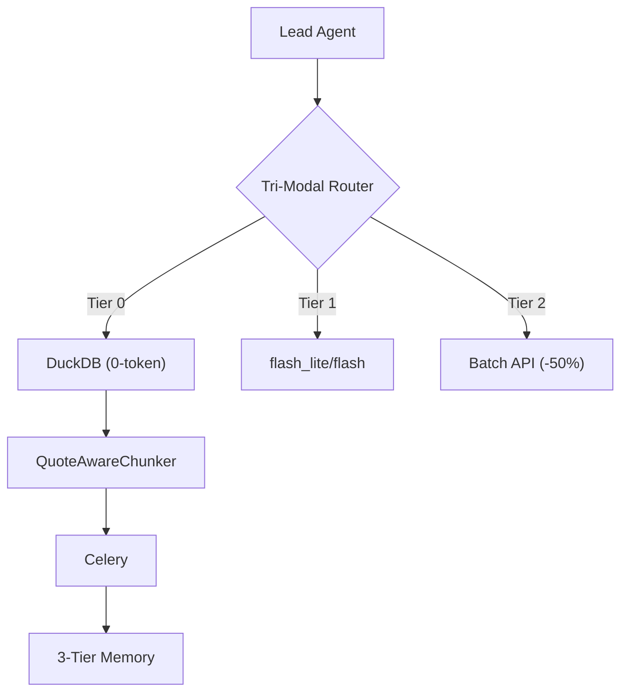

# Cognitive Architecture & Deterministic Agent System

> Decoupled Architecture cho AI Agent xử lý Big Data kết hợp Deterministic Token Engine & Cognitive Architecture.

## Mục lục
- [1. Kiến trúc Tổng thể](#1-kiến-trúc-tổng-thể)
- [2. Phân hệ Cốt lõi](#2-phân-hệ-cốt-lõi)
- [3. Phân cấp Sub-Agent (Subagent Tiering Protocol)](#3-phân-cấp-sub-agent-subagent-tiering-protocol)
- [4. Deterministic Token Engine](#4-deterministic-token-engine)
- [5. Cài đặt & Khởi động Nhanh](#5-cài-đặt--khởi-động-nhanh)
- [6. Kết quả Kiểm thử (Test Verification)](#6-kết-quả-kiểm-thử-test-verification)
- [7. Tài liệu Kỹ thuật](#7-tài-liệu-kỹ-thuật)

---

## 1. Kiến trúc Tổng thể

Tách biệt **Nhận thức (<3KB)** và **Tính toán Nặng (Out-of-Core)**:



---

## 2. Phân hệ Cốt lõi

1. [Tri-Modal Router](file:///mnt/second_drive/SKILL/tri_modal_router/router.py):
   - **Tier 0 (DuckDB)**: 0-token ($0.00), 10M+ rows/s (lọc, aggregate).
   - **Tier 1 (flash_lite/flash)**: Real-time agent loop (1-5s SLA).
   - **Tier 2 (Batch API)**: Giảm 50% chi phí cho bulk semantic (>1K items).
2. [Data Pipeline](file:///mnt/second_drive/SKILL/data_pipeline):
   - **QuoteAwareChunker**: Scanner RFC 4180, không cắt gãy multiline quotes.
   - **DuckDBWorker**: RAM `PRAGMA max_memory='2GB'`, tràn đĩa chống OOM.
3. [Distributed Queue](file:///mnt/second_drive/SKILL/distributed_queue):
   - Celery Invariants: `task_acks_late=True`, `visibility_timeout >> time_limit`.
   - **TaskDispatcher**: Circuit Breaker, giữ thứ tự partition, giải phóng RAM.
4. [3-Tier Memory Layer](file:///mnt/second_drive/SKILL/memory_layer):
   - **Milvus Lite 3.0.2**: Vector insight cô đọng (<3KB).
   - **BLAKE3 UID**: Hash `tenant_id || task_id || text` chống duplicate.
   - **SourceChunkPointer**: Trỏ bit-for-bit về S3 URI, line range, Git SHA.

---

## 3. Phân cấp Sub-Agent (Subagent Tiering Protocol)

- **Lead Orchestrator** (`inherit`/`pro`): Lập ToT DAG, nghiệm thu, duy trì context <3KB.
- **Worker Chân tay** (`flash_lite`): Quét file, grep, chạy test runner, đọc log/trace lỗi, tra cứu memory recipe.
- **Worker Triển khai** (`flash`): Viết mã nguồn, vá bug cụ thể, sinh unit test, đối soát test case.

---

## 4. Deterministic Token Engine

Thành phần `token_engine/` cung cấp khả năng ước lượng và kiểm soát token budget tất định, có thể tích hợp qua Python SDK (`from token_engine import TokenEngine`).

### Cấu trúc Thành phần:
- **Engine** (`engine.py`): Ước lượng token usage, kiểm soát budget có thể cấu hình, hỗ trợ cơ chế override.
- **Predictor** (`predictor.py`): Heuristic đếm từ đơn giản (hỗ trợ thay thế bằng mô hình ML).
- **Rules** (`rules.py`): Định nghĩa các ngưỡng ngân sách token.
- **Audit** (`audit.py`): Ghi log JSON-lines cho từng request và hỗ trợ xoay vòng file log tự động.
- **CLI** (`cli.py`): Giao diện dòng lệnh tương tác kèm bước xác nhận trước khi thực thi.

---

## 5. Cài đặt & Khởi động Nhanh

> **Cảnh báo Môi trường**: Sử dụng **Python 3.11** (`/usr/bin/python3.11`), tránh Python 3.14 để ngăn ngừa ABI Mismatch với các C-Extensions.

### 📦 Cài đặt Môi trường
```bash
# Clone repository (nếu chưa có)
cd /mnt/second_drive/SKILL

# Khởi tạo virtual environment và cài đặt dependencies
/usr/bin/python3.11 -m venv venv
source venv/bin/activate
pip install -U pip setuptools
pip install -e .
pip install -r requirements.txt
```

### 🚀 Hướng dẫn Sử dụng CLI & Pipeline

#### 1. Chạy Deterministic Token Engine CLI
```bash
source venv/bin/activate
python -m token_engine.cli "<your prompt>"

# Cho phép vượt budget token khi cần (override):
python -m token_engine.cli "<your prompt>" --allow-override
```

#### 2. Chạy Demo Big Data Pipeline
```bash
/usr/bin/python3.11 scripts/run_big_data_pipeline_demo.py
```

---

## 6. Kết quả Kiểm thử (Test Verification)

Toàn bộ hệ thống được bảo chứng với 100% test cases pass:

```bash
# Chạy bộ test Big Data Agent (Tri-Modal Router, Chunker, Celery Queue, Memory Layer)
/usr/bin/python3.11 -m pytest tri_modal_router/ data_pipeline/ distributed_queue/ memory_layer/ -v
# => 28/28 tests PASS (100%)

# Chạy toàn bộ test suite core hệ thống
/usr/bin/python3.11 -m pytest -v
# => 108/108 tests PASS (100%)
```

---

## 7. Tài liệu Kỹ thuật

- 📖 [Setup Agent Chi tiết](file:///mnt/second_drive/SKILL/docs/AGENT_SETUP_GUIDE.md)
- 📐 [Đặc tả Kiến trúc Big Data](file:///mnt/second_drive/SKILL/docs/specs/big_data_agent_architecture_spec.md)
- 🛡️ [Hồ sơ Thẩm định War-Room](file:///mnt/second_drive/SKILL/docs/specs/war_room_arch_audit_defense.md)
