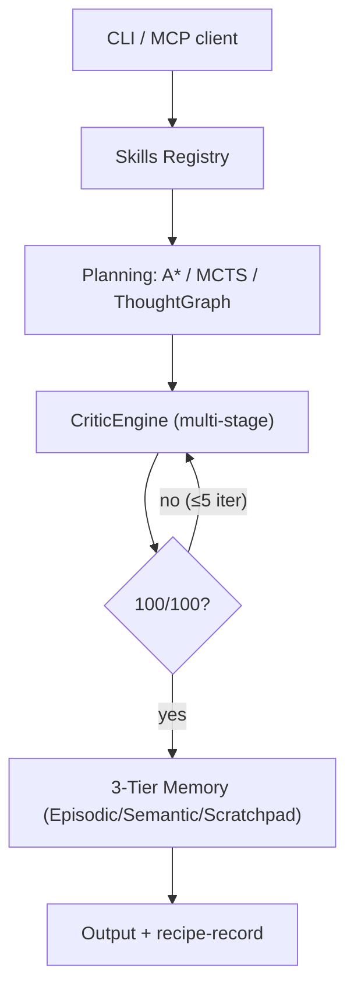

# Agent System — Cognitive Architecture Engine

Domain-agnostic cognitive engine cho AI Agent: semantic + episodic memory (SQLite, optional fastembed vectors), multi-stage critic & self-reflection loop, A*/MCTS planning, 3-tier memory, dynamic skills, và zero-dependency MCP server. Pairs with [FLOW_SKILL](../FLOW_SKILL), a Redis task engine with a cheap `claude -p` worker.

> **Lưu ý (2026-11-20):** cụm Big-Data (`token_engine`, `tri_modal_router`, `data_pipeline`, `distributed_queue`, `coordination_service`, `memory_layer`) đã được **archive** sang `Archive/bigdata-v04/` — không còn là phần chạy của engine. Tài liệu Big-Data cũ nằm trong `Archive/bigdata-v04/` và trong repo chị-em `/mnt/second_drive/SKILL`. Repo này giờ tập trung vào **cognitive engine** (`agent_system/`).

## Cài đặt & tích hợp FLOW_SKILL (agent-system)

```bash
pip install -e ".[embed]"        # drop [embed] for BM25-only memory (no model download)
agent-system install --target mcp   # register the MCP server in Claude Desktop, Cursor, Windsurf, Antigravity
agent-system doctor              # DB, embeddings, registered clients, flow-task bridge
```
`agent-system install` (default `--target all`) also writes the Universal Operating Protocol into `~/.claude/CLAUDE.md`, `~/.gemini/.../AGENTS.md`, `~/.cursorrules`, `~/.agent/rules.md` as a marked block (`<!-- agent-system:begin -->`) and never touches the rest of those files. Claude Code CLI: `claude mcp add agent-system -- agent-system mcp`.

Memory lives in `~/.agent_system/agent_system.db` (`AGENT_SYSTEM_DB_DIR` moves it; `AGENT_SYSTEM_NO_EMBED=1` forces BM25). `AGENT_SYSTEM_LLM_PATCH=1` lets `reflect` call a cheap Claude model for violations the rule patcher cannot fix.

## Wiring with FLOW_SKILL
- MCP tools `flow_task_submit` / `flow_task_status` queue work, and `flow_plan_create` / `flow_plan_approve` / `flow_plan_status` run plan → your OK → parallel sub-agents → evidence report, on the task engine (`flow-task` found next to this interpreter, on PATH, or via `FLOW_TASK_BIN`; absent = a clear error, nothing breaks).
- FLOW calls back into `agent-system memory search | index | recipe-record` around every task.

## Mục lục
- [1. Kiến trúc Tổng thể](#1-kiến-trúc-tổng-thể)
- [2. Phân hệ Cốt lõi (cognitive engine)](#2-phân-hệ-cốt-lõi-cognitive-engine)
- [3. 3-Tier Memory](#3-3-tier-memory)
- [4. Phân cấp Sub-Agent (FLOW_SKILL)](#4-phân-cấp-sub-agent-floskill)
- [5. Cài đặt & Khởi động Nhanh](#5-cài-đặt--khởi-động-nhanh)
- [6. Kết quả Kiểm thử](#6-kết-quả-kiểm-thử)
- [7. Tài liệu Kỹ thuật](#7-tài-liệu-kỹ-thuật)

---

## 1. Kiến trúc Tổng thể

Tách biệt **Nhận thức (<3KB)** và **Tự kiểm chứng** — mọi output phải qua Critic + Reflection trước khi bàn giao:



---

## 2. Phân hệ Cốt lõi (cognitive engine)

Cả trong package `agent_system/`:

| Module | Trách nhiệm |
|---|---|
| `core/` | Contracts (`TaskGoal`, `Plan`, `ThoughtNode`), `StructuralTruncator` (budget <3KB, giữ nguyên vẹn JSON/UTF-8), `SessionManager` |
| `reasoning/` | `ThoughtGraph` (DAG + cycle detection), `AStarPlanner` (tất định), `MCTSPlanner` (ngẫu nhiên/rollout) |
| `reflection/` | `CriticEngine` + adapters (`PythonAstCritic` cấm `eval/exec/breakpoint`), `SelfReflector` (vòng vá lỗi ≤5 lần) |
| `memory/` | 3 tầng: Episodic (recipe), Semantic (FTS5 BM25 + fastembed), Scratchpad |
| `skills/` | Scan + validate + inject `SKILL.md` (frontmatter zero-dep) |
| `sdk/` | Pluggable SDK, `CodebaseScanner`, brownfield ingestion, `OnboardingWizard` |
| `distillation/` | Tối ưu prompt ngoại tuyến |
| `mcp/` | MCP stdio server zero-dependency (JSON-RPC 2.0), 8 cognitive tools |
| `cli/` | CLI + UNIX pipe (`init`, `scan`, `mcp`, `plan`, `critic`, `reflect`, `memory`, `skill`, `session`) |
| `flow.py` / `doctor.py` | Bridge FLOW_SKILL task-engine + health report |

---

## 3. 3-Tier Memory
- **Episodic** — recipe problem→recovery (`recipe-record`, `recipe-get`).
- **Semantic** — SQLite FTS5 BM25, fallback pure-Python; optional fastembed vector (`memory_vectors`).
- **Scratchpad** — transient key-value trong phiên.
- Persistence: `SQLiteStore` — `PRAGMA journal_mode=WAL`, `busy_timeout=5000` (an toàn concurrency).

---

## 4. Phân cấp Sub-Agent (FLOW_SKILL)
- **Lead Orchestrator** (`inherit`/`pro`): lập plan, nghiệm thu, duy trì context <3KB.
- **Worker** (`flash_lite`): quét file, grep, chạy test, đọc log, tra memory recipe.
- **Triển khai** (`flash`): viết code, vá bug, sinh unit test.
- Cổng phê duyệt người: `flow_plan_approve` — chỉ chạy song song sau khi anh OK.

---

## 5. Cài đặt & Khởi động Nhanh

> **Cảnh báo Môi trường**: Dùng **Python 3.11** (`/usr/bin/python3.11`), tránh Python 3.14 cho các C-extension nhạy ABI.

```bash
cd /mnt/second_drive/Agent_system
/usr/bin/python3.11 -m venv .venv
.venv/bin/pip install -U pip setuptools
.venv/bin/pip install -e ".[embed]"
```

```bash
# Chạy cognitive CLI
agent-system scan --root .
agent-system init --auto
agent-system mcp
.venv/bin/python -m agent_system.cli.main plan --initial state.json --goal-key is_ready
```

> Big-Data pipeline (token_engine, tri_modal_router…) — xem `Archive/bigdata-v04/README` hoặc repo `/mnt/second_drive/SKILL`.

---

## 6. Kết quả Kiểm thử (Test Verification)

```bash
# Toàn bộ test suite cognitive engine
.venv/bin/python -m pytest tests/ -v
# => 115 passed (100%) — verified 2026-11-20
```

---

## 7. Tài liệu Kỹ thuật

- 📖 [Project Map](docs/PROJECT_MAP.md)
- 📐 [Specs](docs/specs/) · [ADRs](docs/decisions/) · [Design RFC (THIẾT v2.0)](docs/reference/rfc-agent-design.md)
- 🗺️ [Capability Map v2.0 Remediation](CAPABILITY_MAP.md)
- 🧪 [Failure Taxonomy](docs/failure-taxonomy.md) (module `error-taxonomy`)
- 📦 [Archive Big-Data v0.4](Archive/bigdata-v04/) (không phải phần chạy)
