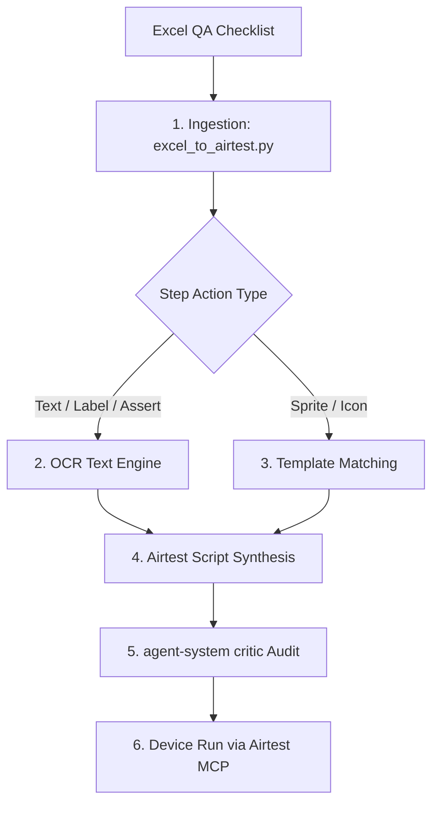

# Airtest Excel & OCR Testcase Generator

Generates executable, self-healing Airtest mobile game test scripts from Excel/CSV QA matrices using a Dual-Vision pipeline (Image Template matching + OCR text detection) without relying on Poco SDK.

---

## 1. When to Use

- Generating Airtest test scripts from Excel or CSV QA checklists (`.xlsx`, `.csv`).
- Automating mobile games (Unity, Unreal, Cocos) where Poco UI SDK is unavailable or disabled.
- Tapping dynamic text labels (e.g., "PLAY", "CLAIM", "REVIVE") and asserting on-screen text via OCR.
- Handling unexpected dialog popups during gameplay test execution.

---

## 2. Architecture & Pipeline



---

## 3. Quickstart & Command Usage

Run the generator against an Excel or CSV checklist:

```bash
# Generate Airtest scripts from test matrix
python3 scripts/excel_to_airtest.py \
  --input /path/to/test_cases.csv \
  --output-dir ./generated_tests \
  --package com.mygame.mobile
```

### Action Syntax in Excel:
- `Tap "PLAY"` -> OCR scan for text `"PLAY"` and tap center coordinates.
- `Tap btn_setting.png` -> Image Template match against `btn_setting.png`.
- `Wait 3s` -> `sleep(3)`.
- `See "VICTORY"` -> Assert text `"VICTORY"` appears on screen via OCR.

---

## 4. Execution Phases

- **Phase 1: Matrix Ingestion**: Inspect Excel/CSV headers and normalize steps. See [references/excel-matrix-schema.md](references/excel-matrix-schema.md).
- **Phase 2: Dual-Vision Resolution**: Combine OCR text detection with Template fallback. See [references/dual-vision-engine.md](references/dual-vision-engine.md).
- **Phase 3: Code Synthesis**: Emit standardized test scripts with self-healing popup killers. See [references/script-templates.md](references/script-templates.md).
- **Phase 4: Static Audit & Run**: Run `agent-system critic --file <file>`; run test on device/emulator.

---

## 5. References & Tools

- Schema & Grammar: [references/excel-matrix-schema.md](references/excel-matrix-schema.md)
- Dual-Vision Engine: [references/dual-vision-engine.md](references/dual-vision-engine.md)
- Script Templates: [references/script-templates.md](references/script-templates.md)
- Generator Script: [scripts/excel_to_airtest.py](scripts/excel_to_airtest.py)
