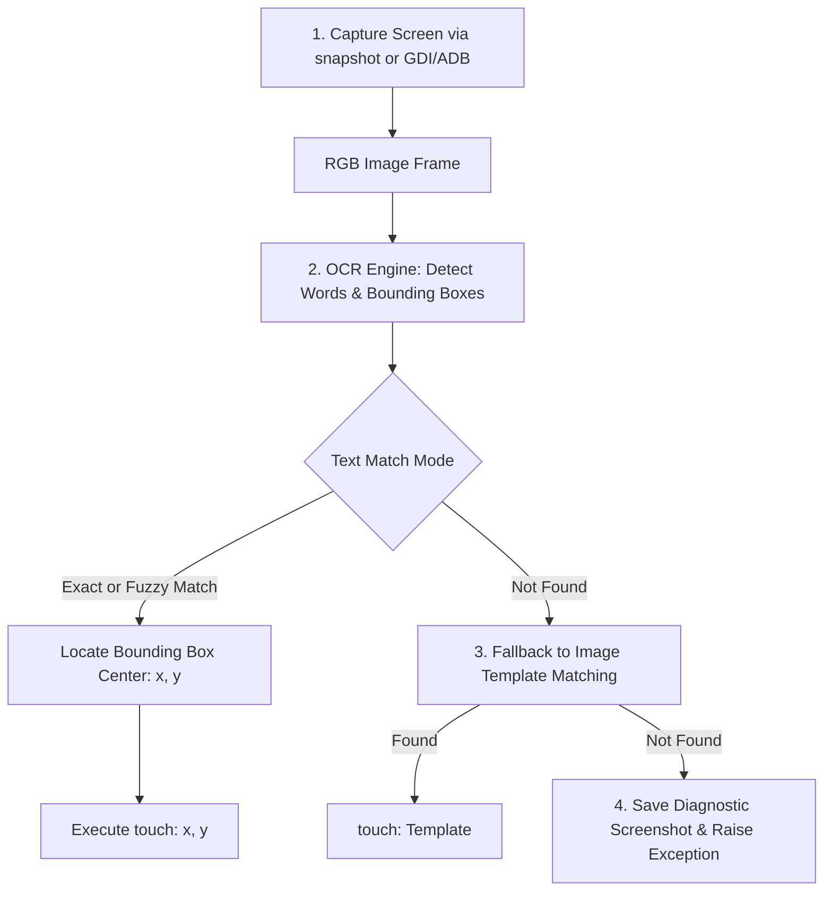

# Dual-Vision Engine: OCR & Template Integration in Airtest

The **Dual-Vision Engine** combines Optical Character Recognition (OCR) with Image Template matching to deliver robust mobile game automation without the Poco UI SDK.

---

## 1. Why Dual-Vision?

In release game builds (Unity, Unreal, Cocos):
- **Image Templates** fail when resolutions scale, assets change seasonal skins, or buttons have dynamic text labels.
- **Poco SDK** is frequently disabled or missing in staging/production packages.
- **OCR** reads text labels directly from rendered game frames, making actions like tapping `"CLAIM"`, `"UPGRADE"`, or verifying `"LEVEL 10"` immune to resolution shifts and skin changes.

---

## 2. OCR Targeting Architecture



---

## 3. Core Implementation Pattern

The generated Airtest script imports and utilizes this standard OCR & Vision helper:

```python
import os
import cv2
import numpy as np
from airtest.core.api import G, touch, snapshot, Template, assert_exists

def find_text_on_screen(target_text: str, threshold: float = 0.7, timeout: int = 10):
    """
    Scans the live game screen for target text via OCR.
    Returns center coordinate (x, y) if found, else None.
    """
    import time
    start_time = time.time()
    
    while time.time() - start_time < timeout:
        screen = G.DEVICE.snapshot()
        # Call OCR detector (PaddleOCR / EasyOCR / Multimodal OCR)
        # Returns list of dicts: [{"text": "...", "box": [[x1, y1], [x2, y2]], "score": 0.95}]
        boxes = perform_ocr(screen)
        
        target_clean = target_text.strip().lower()
        for b in boxes:
            if target_clean in b["text"].lower() and b["score"] >= threshold:
                x_center = int((b["box"][0][0] + b["box"][1][0]) / 2)
                y_center = int((b["box"][0][1] + b["box"][1][1]) / 2)
                return (x_center, y_center)
        time.sleep(1)
    return None

def touch_text(target_text: str, fallback_template: Template = None, timeout: int = 10):
    """
    Attempts to tap a button via OCR. If text is not detected,
    falls back to Image Template matching.
    """
    pos = find_text_on_screen(target_text, timeout=timeout)
    if pos:
        touch(pos)
        return True
    elif fallback_template and exists(fallback_template):
        touch(fallback_template)
        return True
    raise TargetNotFoundError(f"Target UI '{target_text}' not found via OCR or Template.")
```

---

## 4. Fallback Cascade & Error Recovery

1. **OCR Primary**: Check for normalized text string (case-insensitive, whitespace-trimmed).
2. **Template Secondary**: If text fails or is obscured by UI glow/particles, match the visual sprite `Template(...)`.
3. **Popup Recovery**: Before throwing an error, check if an unexpected modal popup (daily reward, rate us, network reconnect) is blocking the view, dismiss it, and re-attempt.
4. **Diagnostic Snapshot**: On failure, save an annotated screenshot highlighting attempted search regions to `.reports/` for immediate inspection.
