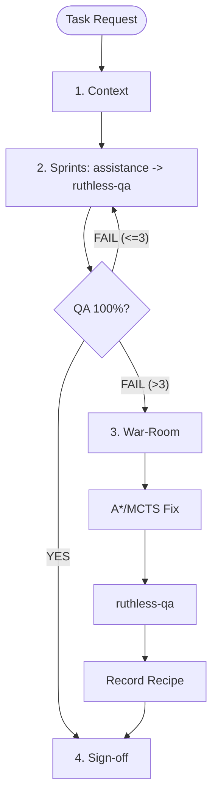

# Core Subagent Team Orchestration

Orchestrates 4 token-optimized subagents under a Dispatcher / Lead Architect. Enforces autonomous execution, continuous governance, an aggressive QA loop (max 3 sprints), and automated War-Room escalation while using lightweight models (`flash_lite` and `flash`) for routine execution tasks to conserve token budget.

---

## 1. When to Use

- Multi-file features, architecture refactors, sensitive logic.
- Code requiring adversarial testing, boundary fuzzing, static audits.
- Automated recovery requiring up to 3 sprints before War-Room.

---

## 2. Subagent Roster

| Subagent | Role | Mission & Capabilities |
| :--- | :--- | :--- |
| **`coordination-brain`** | Dispatching Brain | Tactical Orchestrator. Lập DAG, điều phối song song các worker sub-agents (`flash_lite`/`flash`). |
| **`assistance`** | Implementer | Writes code; in-memory AST repair (`agent-system reflect`). Model: `flash`. |
| **`folder-knowledge-manager`** | Curator | Surveys structure (`agent_scan`); semantic memory (<3KB). Model: `flash_lite`. |
| **`project-rule-manager`** | Gatekeeper | Enforces rules; manages recipes (`agent_memory_recipe_*`). Model: `flash_lite`. |
| **`ruthless-qa`** | Adversarial QA | **Zero Mercy**: Adversarial tests, fuzzing, `critic --strict`. Model: `flash`. |

Full prompts and tools: [references/subagent-prompts.md](references/subagent-prompts.md)

---

## 3. Workflow Lifecycle

---

## 4. Execution Phases

- **Phase 1: Context Bootstrap**: `folder-knowledge-manager` maps files; `project-rule-manager` fetches recipes. Session starts: `scripts/war_room_init.sh init <task_id>`.
- **Phase 2: Agile Sprints (Max 3)**: `assistance` implements code with in-memory reflection. `ruthless-qa` tests against [references/qa-adversarial-matrix.md](references/qa-adversarial-matrix.md). Max 3 sprints. See: [references/agile-iteration-protocol.md](references/agile-iteration-protocol.md).
- **Phase 3: Emergency War-Room**: Triggered if sprint > 3. Halts solo edits, convenes 4 subagents, synthesizes consensus plan (A*/MCTS), and records recipe. See: [references/war-room-protocol.md](references/war-room-protocol.md).
- **Phase 4: Sign-off & Delivery**: `project-rule-manager` audits (`agent-system critic`); deliver with test logs.

---

## 5. References

- Prompts: [references/subagent-prompts.md](references/subagent-prompts.md)
- Sprints: [references/agile-iteration-protocol.md](references/agile-iteration-protocol.md)
- War-Room: [references/war-room-protocol.md](references/war-room-protocol.md)
- QA Matrix: [references/qa-adversarial-matrix.md](references/qa-adversarial-matrix.md)
- Helper: [scripts/war_room_init.sh](scripts/war_room_init.sh)
