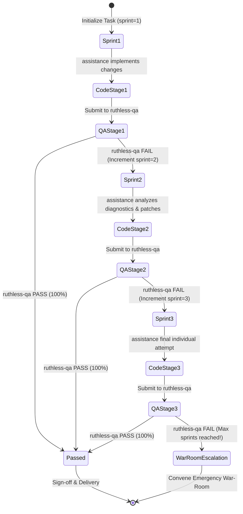

# Agile Iteration Protocol (Max 3 Sprints)

This protocol governs the iterative development and verification cycle between `assistance` (Implementer) and `ruthless-qa` (Adversarial QA). It enforces a strict **maximum of 3 Agile sprints** to prevent circular trial-and-error, backed by persistent session state tracking using `agent-system session`.

---

## 1. Session State Schema

Every task tracked under this protocol utilizes a dedicated session in `agent-system session`:

```bash
# Session Key Schema
agent-system session set --id <task_id> --key "sprint" --value "<1|2|3>"
agent-system session set --id <task_id> --key "status" --value "<SPRINT_ACTIVE|QA_TESTING|QA_PASSED|QA_FAILED|WAR_ROOM_REQUIRED>"
agent-system session set --id <task_id> --key "qa_failures" --value "<structured_failure_summary>"
agent-system session set --id <task_id> --key "modified_files" --value "<comma_separated_paths>"
```

---

## 2. Sprint State Machine



---

## 3. Step-by-Step Sprint Execution

### Step 1: Sprint Initialization
At the start of Sprint $N$ (where $N \in \{1, 2, 3\}$):
```bash
agent-system session set --id <task_id> --key "sprint" --value "$N"
agent-system session set --id <task_id> --key "status" --value "SPRINT_ACTIVE"
```

### Step 2: Implementation & In-Memory Reflection (`assistance`)
1. `assistance` reads the task requirements and any previous failure report from session:
   ```bash
   agent-system session get --id <task_id>
   ```
2. `assistance` writes the implementation.
3. Before writing to disk or declaring readiness, `assistance` runs in-memory self-reflection:
   ```bash
   cat candidate_file.py | agent-system critic --file -
   # Or auto-repair AST defects
   agent-system reflect --file candidate_file.py --max-iterations 3
   ```
4. Once verified, `assistance` writes the file and notifies Dispatcher:
   ```bash
   agent-system session set --id <task_id> --key "status" --value "QA_TESTING"
   ```

### Step 3: Adversarial Verification (`ruthless-qa`)
1. `ruthless-qa` generates standalone test scripts targeting the modified logic.
2. `ruthless-qa` executes the test suite against the live code:
   - Evaluates nominal behavior.
   - Executes edge cases, boundary values, error injection, and race conditions.
   - Runs `agent-system critic --strict` on changed files.
3. **Verdict Generation**:
   * **Case A: All Tests Pass (100%)**:
     ```bash
     agent-system session set --id <task_id> --key "status" --value "QA_PASSED"
     ```
     Task transitions directly to Phase 4 (Sign-off & Memory Sync).
   * **Case B: Any Test Fails**:
     ```bash
     agent-system session set --id <task_id> --key "status" --value "QA_FAILED"
     agent-system session set --id <task_id> --key "qa_failures" --value "<reproducible_failure_trace>"
     ```
     Proceed to Step 4.

### Step 4: Iteration Counter Evaluation
The Dispatcher evaluates the current sprint counter:
- If `sprint < 3`:
  - Increment sprint: `sprint = sprint + 1`.
  - Dispatch the QA failure report to `assistance`.
  - Loop back to Step 2 for the next sprint.
- If `sprint == 3`:
  - **HARD STOP**: Do NOT allow `assistance` to attempt a 4th patch.
  - Set session status:
    ```bash
    agent-system session set --id <task_id> --key "status" --value "WAR_ROOM_REQUIRED"
    ```
  - Trigger Phase 3: **Emergency War-Room Escalation**.

---

## 4. Sprint Diagnostic Report Template

When `ruthless-qa` reports a failure, it must produce this structured diagnostic:

```markdown
### [SPRINT <N> QA VERDICT: REJECTED]
- **Target Unit / Function**: `<module.function>`
- **Failed Test**: `<test_file.py::test_name>`
- **Input Vector**: `<exact payload / arguments that triggered failure>`
- **Expected Outcome**: `<expected behavior / return type>`
- **Actual Outcome**: `<exception / incorrect state / assertion error>`
- **Stack Trace / Error Output**:
  ```text
  <paste full trace here>
  ```
- **Root Cause Hypothesis**: `<QA engineer's observation on why it broke>`
```
