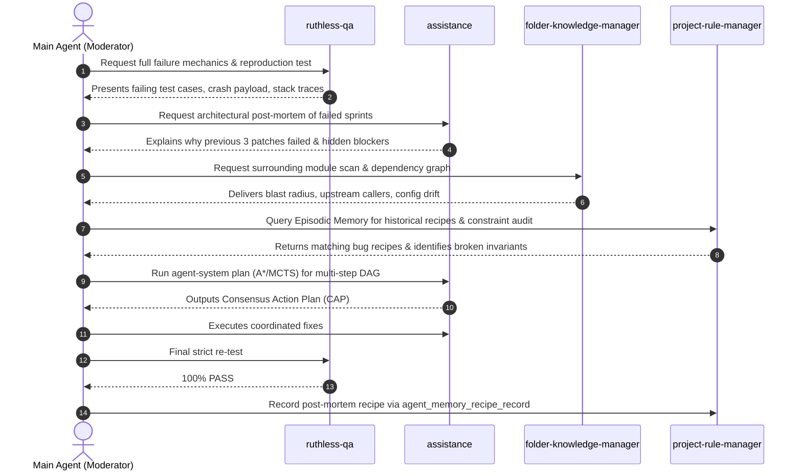

# Emergency War-Room Protocol

The **Emergency War-Room** is an escalation mechanism triggered automatically when a task fails verification across **3 consecutive Agile sprints**. It halts single-agent trial-and-error, convenes all 4 subagents in a synchronized diagnostic session, and synthesizes a mathematical recovery plan.

---

## 1. Trigger Conditions & Immediate Actions

### Trigger Invariant:
$$\text{Sprint Count} \ge 3 \quad \land \quad \text{QA Verdict} = \text{FAIL}$$

### Immediate Actions:
1. **Lock the Task State**:
   ```bash
   agent-system session set --id <task_id> --key "status" --value "WAR_ROOM_ACTIVE"
   ```
2. **Halt Uncoordinated Modifications**: `assistance` is prohibited from making further standalone edits.
3. **Assemble the War-Room Panel**: The Dispatcher invokes or messages all 4 subagents with the War-Room agenda.

---

## 2. War-Room Meeting Structure & Agenda



---

## 3. Subagent Roles During the War-Room

### 1. Main Agent (War-Room Chair & Moderator)
- Opens the meeting, outlines the initial goal, and states the 3 failed sprint attempts.
- Coordinates turn-taking between subagents; prevents repetitive circular arguments.
- Synthesizes the final **Consensus Action Plan (CAP)**.

### 2. `ruthless-qa` (Failure Mechanics Presenter)
- Delivers the exact failing test harness and input data.
- Explains the specific invariants that were violated (e.g., race condition, data corruption, unhandled edge cases).
- Defines the non-negotiable acceptance criteria required to pass.

### 3. `assistance` (Technical Debottlenecker)
- Explains the root technical obstacle that prevented the previous 3 sprints from succeeding.
- Distinguishes between localized code bugs and deeper architectural/contract flaws.
- Proposes a structural redesign rather than another cosmetic patch.

### 4. `folder-knowledge-manager` (Blast-Radius Investigator)
- Performs a deep survey of the surrounding files using `agent_scan` or search tools.
- Pinpoints external side-effects: shared state, database schemas, environment configs, or unmocked upstream APIs.

### 5. `project-rule-manager` (Memory & Invariant Auditor)
- Searches Episodic Memory for recovery recipes:
  ```bash
  agent-system memory recipe-get --key "<ERROR_SIGNATURE>"
  ```
- Evaluates if the design violated foundational system constraints recorded in `AGENTS.md`.

---

## 4. Mathematical Recovery Planning via A* / MCTS

When a bug requires coordinated changes across multiple files or subsystems, the War-Room formulates a formal state transition plan using `agent-system plan`:

```bash
# Deterministic shortest-path recovery plan
agent-system plan \
  --initial war_room_initial_state.json \
  --actions recovery_actions.json \
  --goal-key "all_tests_passing" \
  --goal-value "true" \
  --method astar
```

The resulting Directed Acyclic Graph (DAG) defines the strict execution order for applying patches across components.

---

## 5. Post-Mortem & Episodic Recipe Recording

Once the consensus fix is implemented and `ruthless-qa` verifies a 100% test pass, the War-Room is formally closed by recording an Episodic Memory Recipe.

### Mandatory Recipe Record Command:
```bash
agent-system memory recipe-record \
  --key "RECIPE_<SUBSYSTEM>_<DEFECT_KEY>" \
  --recipe "Root Cause: <cause>. Prevention/Fix: <solution_steps>. Verified by: ruthless-qa."
```

### Purpose:
This guarantees that the entire agent system permanently retains the solution. If the same error pattern is encountered in future tasks, `project-rule-manager` retrieves the recipe during Phase 1, preventing repeat failures.

---

## 6. Escalation to Human User (Insurmountable Blocker)

If the War-Room determines that the defect is caused by an external insurmountable factor (e.g., missing third-party credentials, upstream service downtime, contradictory business requirements):
1. The War-Room creates a transparent **War-Room Incident Report**.
2. Presents exact evidence, diagnostic logs, and 2-3 actionable human decision options.
3. Halts further automated writes until user direction is received.
