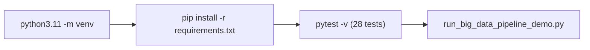

# Agent Onboarding & Setup Guide

> Chuẩn bị môi trường, kiểm thử và tích hợp Agent Cognitive System.

## Mục lục
- [1. Cảnh báo Python 3.11 ABI](#1-cảnh-báo-python-311-abi)
- [2. Quy trình Bootstrap](#2-quy-trình-bootstrap)
- [3. Cấu hình Biến Môi trường](#3-cấu-hình-biến-môi-trường)
- [4. Kiểm thử & Chạy Demo](#4-kiểm-thử--chạy-demo)
- [5. Tích hợp CLI & MCP Tools](#5-tích-hợp-cli--mcp-tools)

---

## 1. Cảnh báo Python 3.11 ABI

> [!WARNING]
> **BẮT BUỘC DÙNG PYTHON 3.11 (`/usr/bin/python3.11`)**
> Tránh symlink trỏ vào **Python 3.14** (experimental). C-Extensions (`duckdb`, `blake3`) sẽ bị **ABI Mismatch**, gây lỗi segfault hoặc symbol lookup failure!

---

## 2. Quy trình Bootstrap



```bash
/usr/bin/python3.11 -m venv venv
source venv/bin/activate
pip install -r requirements.txt
```

---

## 3. Cấu hình Biến Môi trường

Thêm vào file `.env` hoặc export shell:
```bash
# Milvus Lite & Celery Broker (fallback in-memory khi không có Redis)
export MEMORY_DB="/mnt/second_drive/SKILL/memory_layer/milvus_lite.db"
export CELERY_BROKER_URL="redis://localhost:6379/0"
export CELERY_RESULT_BACKEND="redis://localhost:6379/1"
export GIT_COMMIT_SHA="$(git rev-parse HEAD 2>/dev/null || echo HEAD)"
export TENANT_ID="default_agent_workspace"
```

---

## 4. Kiểm thử & Chạy Demo

```bash
# 1. Chạy 28 unit & integration tests
/usr/bin/python3.11 -m pytest -v

# 2. Chạy kịch bản Demo toàn trình
/usr/bin/python3.11 scripts/run_big_data_pipeline_demo.py
```

*5 bước thực thi demo*:
1. **Tri-Modal Route**: Xác định Tier 0 (0-token, $0.00).
2. **QuoteAwareChunker**: Cắt file RFC 4180 không nát quotes.
3. **DuckDBWorker**: Map song song với RAM giới hạn.
4. **Reduce**: Tổng hợp kết quả chính xác 100%.
5. **Memory Ingestion**: Ghi insight kèm `SourceChunkPointer`.

---

## 5. Tích hợp CLI & MCP Tools

Agent vận hành qua bộ công cụ `agent-system`:
- `agent-system plan` (`agent_plan`): Lập kế hoạch ToT/GoT DAG phi tuyến.
- `agent-system critic` (`agent_critic`): Thẩm định static audit đạt 100/100.
- `agent-system reflect` (`agent_reflect`): Tự vá vi phạm trong RAM (N <= 3).
- `agent-system memory search` (`agent_memory_search`): Tra cứu semantic context.
- `agent-system memory recipe-record` (`agent_memory_recipe_record`): Ghi bài học lỗi.
- `agent-system init --auto --root .` (`agent_init_auto`): Khởi tạo dự án mới.

Tham chiếu: [README.md](file:///mnt/second_drive/SKILL/README.md) | [Spec Kiến trúc](file:///mnt/second_drive/SKILL/docs/specs/big_data_agent_architecture_spec.md)
