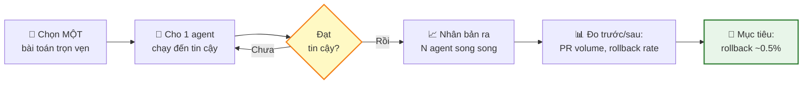
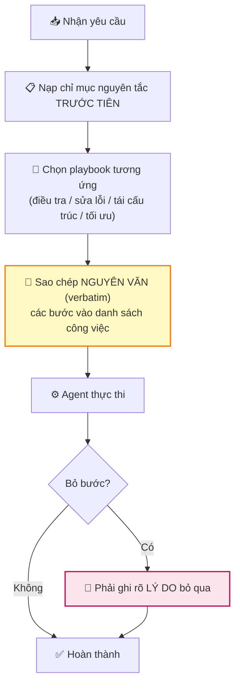
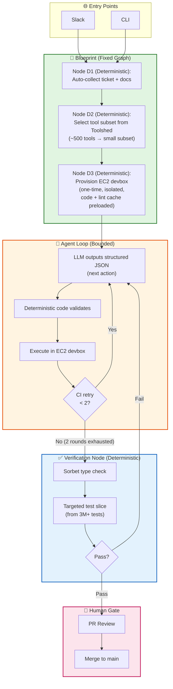
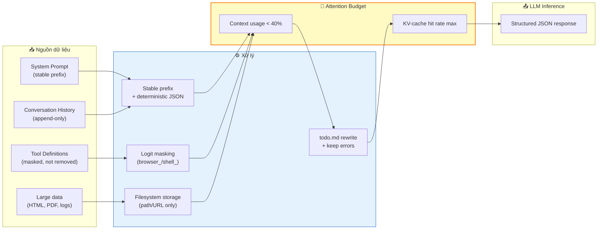
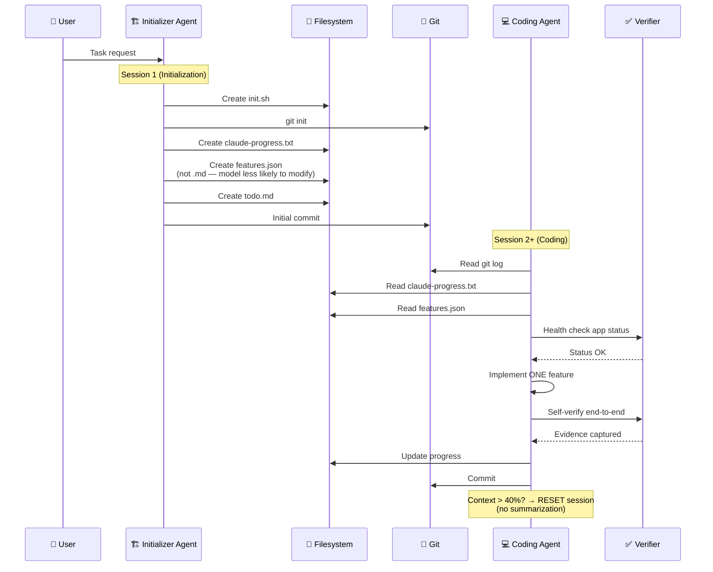
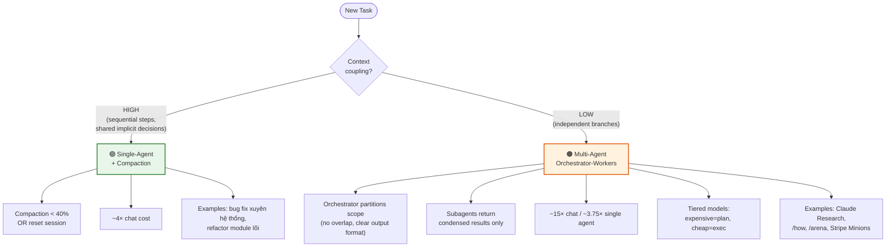
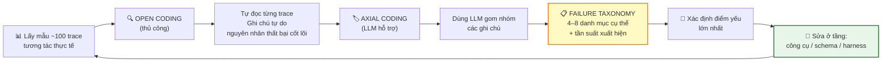
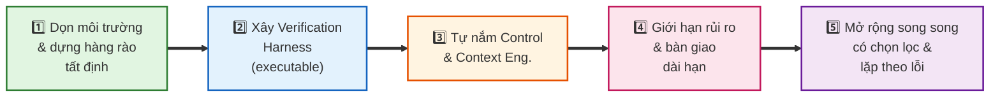

# 📘 TÀI LIỆU NỘI BỘ: THIẾT KẾ & TRIỂN KHAI HỆ THỐNG AI AGENT

---

## 📋 MỤC LỤC

- [0. Thông tin tài liệu & Cảnh báo độ tin cậy](#0)
- [1. Tóm tắt điều hành](#1)
- [PHẦN I — CHẨN ĐOÁN: GÓC NHÌN LAUREN TAN](#2)
  - [2. Nút thắt người kiểm chứng (Verifier Bottleneck)](#2-1)
  - [3. Nguyên tắc "Đi sâu trước khi đi rộng"](#2-2)
  - [4. Tháp Niềm tin (The Trust Pyramid)](#2-3)
  - [5. Phép ẩn dụ khu vườn (Garden Analogy)](#2-4)
  - [6. Bộ công cụ pstack](#2-5)
- [PHẦN II — NĂM VẤN ĐỀ CỐT LÕI](#3)
- [PHẦN III — NGUYÊN LÝ THIẾT KẾ HỆ THỐNG PRODUCTION](#4)
  - [7. Ma trận 6 đội ngũ tiên phong](#4-0)
  - [8. Kiến trúc Hybrid (Tất định kiểm soát Bất định)](#4-1)
  - [9. Context Engineering & Kinh tế KV-Cache](#4-2)
  - [10. ACI & Harness cho tác vụ dài hạn](#4-3)
  - [11. Ma trận Đơn luồng vs Đa-Agent](#4-4)
  - [12. Đánh giá qua Phân tích lỗi](#4-5)
- [PHẦN IV — LỘ TRÌNH TRIỂN KHAI 5 BƯỚC](#5)
- [PHẦN V — MASTER CHECKLISTS](#6)
- [PHẦN VI — RISK REGISTER](#7)
- [PHẦN VII — METRICS & KPIs](#8)
- [PHẦN VIII — PHỤ LỤC: TEMPLATES & GLOSSARY](#9)
- [PHẦN IX — PHÊ DUYỆT](#10)

---

<a name="0"></a>
## 0. THÔNG TIN TÀI LIỆU & CẢNH BÁO ĐỘ TIN CẬY

### 0.1 Metadata

| Trường | Giá trị |
|---|---|
| **Mã tài liệu** | `ENG-AGENT-DESIGN-v2.0` |
| **Loại** | RFC / Design Doc nội bộ |
| **Trạng thái** | 🟡 Draft → Review → ✅ Approved |
| **Phiên bản** | 2.0 (bản đầy đủ, bám sát nguồn) |
| **Chủ sở hữu** | Principal Engineer / AI Platform Lead |
| **Đối tượng đọc** | EM, Tech Lead, SWE, SRE, QA Lead, AI Platform Engineer |
| **Nguồn tham chiếu** | Lauren Tan (pstack/Dune) — tọa đàm "Are Agents About to Replace Software Engineering?" + bài giảng "All Code Is Slop (Except Mine)" (2026); Stripe Minions; HumanLayer (Dex Horthy); Manus AI (Yichao 'Peak' Ji); Anthropic (Building Effective Agents, ACI, Long-Running Harness); Cognition (Walden Yan, "Don't Build Multi-Agents") |
| **Chu kỳ review** | Hàng quý, hoặc khi có sự cố production P1 |

### 0.2 ⚠️ CẢNH BÁO ĐỘ TIN CẬY DỮ LIỆU (bắt buộc đọc trước khi áp dụng)

> **Hai giới hạn quan trọng của nguồn:**
>
> **Thứ nhất — nguồn thứ cấp:** Các phân tích về tọa đàm "Are Agents About to Replace Software Engineering?" được tổng hợp từ bài viết chuyên sâu và tóm tắt kỹ thuật thứ cấp về quy trình làm việc của Lauren Tan (**bản ghi video gốc không kèm toàn văn lời thoại trong dữ liệu nguồn**), kết hợp trực tiếp với tài liệu bài giảng "All Code Is Slop (Except Mine)" năm 2026.
>
> **Thứ hai — số liệu chưa đối sánh độc lập:** Các số liệu hiệu suất gây chú ý đều xuất phát từ **chia sẻ doanh nghiệp, chưa có đối sánh học thuật độc lập**:
> - 1,000–2,500 PR/tháng (Lauren Tan tự báo cáo)
> - >1,300 PR/tuần tại Stripe (tài liệu tổng hợp kỹ thuật)
> - 90.2% cải thiện trên bộ đánh giá nội bộ Anthropic
>
> **Cảnh báo của chính kỹ sư trong ngành:** Số lượng PR là thước đo **dễ gây ngộ nhận** — một PR do AI tạo ra có thể chỉ sửa lỗi chính tả hoặc tinh chỉnh nhỏ lẻ.
>
> **Giá trị thực sự của nguồn:** Nằm ở những **mẫu hình thiết kế (design patterns) đã trả giá bằng hàng nghìn giờ vận hành production** — không phải ở con số. Áp dụng pattern, không chạy đua con số.

---

<a name="1"></a>
## 1. TÓM TẮT ĐIỀU HÀNH

### 1.1 Tuyên bố định vị
AI agent **chưa thay thế** kỹ thuật phần mềm, nhưng đang **tái định nghĩa vai trò kỹ sư**:
- Từ người trực tiếp gõ mã nguồn
- → **Kiến trúc sư môi trường** (environment architect)
- → **Người xây dựng khung kiểm chứng** (harness builder)
- → **Người điều phối các hệ thống tự trị** (orchestrator of autonomous systems)

### 1.2 Chẩn đoán cốt lõi
Điểm nghẽn quyết định thành bại **KHÔNG** nằm ở:
- ❌ Tốc độ sinh code
- ❌ Năng lực thô của mô hình

Mà nằm ở **3 trụ cột**:
- ✅ **Năng lực tự kiểm chứng** (verification)
- ✅ **Kỹ thuật ngữ cảnh** (context engineering)
- ✅ **Đặt vòng lặp bất định (agentic) dưới sự kiểm soát của khung điều phối tất định (deterministic)**

### 1.3 Kết quả kỳ vọng

| Chỉ số | Mục tiêu |
|---|---|
| Rollback rate | ≤ 0.5% |
| Agent tự chứng minh kết quả (không cần người đọc diff) | > 90% task |
| Context usage | Luôn < 40% (Dumb Zone) |
| Trần retry CI | ≤ 2 vòng trước bàn giao người |
| Token budget dịch chuyển sang verification | ~70% |

---

<a name="2"></a>
# PHẦN I — CHẨN ĐOÁN: GÓC NHÌN LAUREN TAN

### 1.4 Hồ sơ tác giả
**Lauren Tan (@poteto)** — Principal Engineer tại SpaceXAI/SpaceXSI. Trước đó:
- **Cursor** (Staff Software Engineer)
- **Meta** — thành viên đội ngũ nòng cốt phát triển **React Compiler**
- **Netflix** — quản lý kỹ thuật

Định vị: góc nhìn **đi ngược lại làn sóng chạy đua số lượng agent**.

---

<a name="2-1"></a>
## 2. NÚT THẮT NGƯỜI KIỂM CHỨNG (THE VERIFIER BOTTLENECK)

### 2.1 Chẩn đoán gốc
> "Lý do khiến các đội ngũ không thể mở rộng số lượng agent chạy song song là **nút thắt người kiểm chứng**."

**Cơ chế nút thắt:**

```
┌─────────────────────────────────────────────────────────────┐
│  NẾU AGENT KHÔNG THỂ TỰ:                                    │
│    ✗ Khởi chạy ứng dụng                                     │
│    ✗ Điều khiển giao diện                                   │
│    ✗ Kiểm tra dấu vết CPU/bộ nhớ                            │
│    ✗ Tái lập lỗi                                            │
│                                                             │
│  → CON NGƯỜI BUỘC PHẢI:                                     │
│    • Tự đọc TỪNG DÒNG DIFF để xác nhận kết quả              │
│                                                             │
│  → KỸ SƯ CON NGƯỜI LÀ TÀI NGUYÊN KHÔNG CHẠY SONG SONG       │
│                                                             │
│  → KÍCH HOẠT THÊM HÀNG CHỤC CODING AGENT KHI THIẾU HỆ     │
│     THỐNG TỰ KIỂM CHỨNG CHỈ LÀM:                            │
│     NHÂN BẢN MÃ RÁC (SLOP) NHANH HƠN                        │
└─────────────────────────────────────────────────────────────┘
```

### 2.2 Checklist đánh giá năng lực tự kiểm chứng

Trước khi mở rộng bất kỳ hệ thống agent nào, trả lời 5 câu hỏi:

| # | Câu hỏi | Có/Không | Hành động nếu Không |
|---|---|---|---|
| Q1 | Agent tự khởi chạy được ứng dụng (không cần người bấm nút)? | ☐ | Xây script auto-start |
| Q2 | Agent tự điều khiển được giao diện / luồng người dùng? | ☐ | Xây Feature Map + CDP/Playwright |
| Q3 | Agent đọc được dấu vết CPU/bộ nhớ (profiling trace)? | ☐ | Tích hợp profiler |
| Q4 | Agent tái lập được lỗi (reproduce) mà không cần người chỉ điểm? | ☐ | Xây repro script |
| Q5 | Agent tự chứng minh kết quả đúng miền tác động (CLI/perf/UI)? | ☐ | Xây acceptance criteria |

> 🚨 **Nếu Q1–Q4 đều "Không"** → **CHƯA ĐƯỢC CHẠY SONG SONG**. Chỉ chạy 1 agent và dùng người review diff.

---

<a name="2-2"></a>
## 3. NGUYÊN TẮC "ĐI SÂU TRƯỚC KHI ĐI RỘNG" (GO DEEP BEFORE BROAD)

### 3.1 Bằng chứng thực chiến của Lauren Tan

> Kinh nghiệm vận hành **hơn 30 agent trong vòng lặp** với công cụ `/pstack`:
> - Có thời điểm **tự động kiểm chứng và gộp 20 PR vào nhánh chính qua đêm** mà không ghi nhận hồi quy
> - Đạt sản lượng tự báo cáo từ **hơn 1,000 lên 2,000–2,500 PR/tháng**
> - Ở quy mô đội ngũ: **khoảng 11,000 PR/tháng** với **tỷ lệ hoàn tác tương đối quanh mức 0.5%** (theo bài chia sẻ năm 2026)

### 3.2 Lộ trình thực thi



### 3.3 Checklist
- [ ] Chọn **một bài toán trọn vẹn** end-to-end (ví dụ: sửa bug X trong module Y)
- [ ] Cho 1 agent chạy đến khi **đáng tin hoàn toàn** (không hồi quy, không cần người sửa)
- [ ] Đo baseline: PR volume, rollback rate, review time
- [ ] Chỉ khi đạt → mới nhân bản ra N agent song song
- [ ] Đo lại sau mở rộng: rollback rate mục tiêu ~0.5%

---

<a name="2-3"></a>
## 4. THÁP NIỀM TIN (THE TRUST PYRAMID)

### 4.1 Triết lý
Phân bổ công sức kỹ thuật từ **tầng cứng rắn nhất** đến **tầng mềm dẻo nhất**. Ưu tiên sửa ở tầng thấp trước.

### 4.2 Sơ đồ Tháp Niềm tin

```
                              ▲
                             ╱ ╲
                            ╱   ╲
                           ╱  3  ╲      TẦNG 3: CHỈ DẪN VĂN XUÔI
                          ╱ PROSE ╲     ────────────────────────
                         ╱─────────╲    AGENTS.md, SKILL.md, comments
                        ╱           ╲   Ưu tiên: THẤP NHẤT
                       ╱    TẦNG 2   ╲  Chỉ cho đánh giá CHỦ QUAN
                      ╱  RUNTIME &    ╲ không thể tự động kiểm tra
                     ╱    FORMAL       ╲────────────────────────
                    ╱   VERIFICATION    ╲TẦNG 2: KIỂM CHỨNG THỰC THI
                   ╱─────────────────────╲& HÌNH THỨC
                  ╱                       ╲Chạy app thật, UI property test,
                 ╱         TẦNG 1          ╲mô hình hóa toán học
                ╱   CODEBASE & STATIC       ╲Ưu tiên: TRUNG BÌNH
               ╱      ANALYSIS               ╲Thu thập bằng chứng hành vi
              ╱───────────────────────────────╲────────────────────────
             ╱                                 ╲TẦNG 1: CODEBASE &
            ╱  Kiến trúc thư mục, API design,  ╲PHÂN TÍCH TĨNH
           ╱   types, compiler, lint rules       ╲Ưu tiên: CAO NHẤT
          ╱───────────────────────────────────────╲Triệt tiêu cơ học
         ╱                                         ╲lựa chọn sai
        ╱───────────────────────────────────────────╲
```

### 4.3 Chi tiết Tầng 1 — Codebase & Phân tích tĩnh (Tất định, ưu tiên cao nhất)

| Khía cạnh | Nội dung |
|---|---|
| **Thành phần** | Kiến trúc thư mục, thiết kế API, hệ thống kiểu (types), trình biên dịch, luật lint |
| **Cơ chế tác động** | Triệt tiêu cơ học các lựa chọn sai lầm; **ép agent tạo mã đúng ngay từ đầu** |

**Thực hành điển hình của Lauren Tan (Dune & pstack):**
- [ ] **Cấm hoàn toàn `useEffect`** trong code sản phẩm (chỉ cho phép trong lõi framework Dune)
- [ ] **Tách biệt `electron-main` và `electron-renderer`** qua bộ phân tích đồ thị phụ thuộc (dependency graph)
- [ ] **Cấm các timer mệnh lệnh** (`setTimeout`, `requestAnimationFrame`, `requestIdleCallback`) kèm **thông báo lỗi hướng dẫn sửa tận gốc**

### 4.4 Chi tiết Tầng 2 — Kiểm chứng Thực thi & Hình thức

| Khía cạnh | Nội dung |
|---|---|
| **Thành phần** | Chạy app thật, kiểm thử thuộc tính UI, mô hình hóa toán học |
| **Cơ chế tác động** | Thu thập bằng chứng hành vi thực tế; **thay thế việc đọc diff thủ công bằng bằng chứng đầu ra** |

**Thực hành điển hình:**
- [ ] **Chạy app qua Chrome DevTools Protocol** kết hợp **Feature Map**
- [ ] **TLA+** — kiểm chứng luồng thông báo đa thiết bị (multi-device notification)
- [ ] **Lean** — chứng minh thuật toán ảo hóa không giật lag
- [ ] **Bombadil** — kiểm thử bất biến UI (UI invariant testing)

### 4.5 Chi tiết Tầng 3 — Chỉ dẫn Văn xuôi (ưu tiên thấp nhất)

| Khía cạnh | Nội dung |
|---|---|
| **Thành phần** | `AGENTS.md`, `SKILL.md`, bình luận code (comments) |
| **Cơ chế tác động** | Chỉ dành cho đánh giá **chủ quan không thể tự động kiểm tra** |

**Thực hành điển hình:**
- [ ] Dùng `/no-comments` — xóa bỏ phần lớn comment giải thích giải pháp tạm (workaround)
- [ ] Tránh tạo "giấy phép" cho các agent sau sao chép mẫu xấu

---

<a name="2-4"></a>
## 5. PHÉP ẨN DỤ KHU VƯỜN (THE GARDEN ANALOGY)

### 5.1 Luận điểm phản trực giác
> **Chính kho mã nguồn (codebase) là dữ liệu ngữ cảnh đầu vào lớn nhất của agent.**

### 5.2 Cơ chế thất bại

```
Agent lặp lại một lỗi
        ↓
Thói quen lập trình viên: viết thêm cảnh báo vào AGENTS.md
                          hoặc để lại bình luận giải thích trong code
        ↓
Hướng dẫn bằng văn xuôi RẤT DỄ BỊ BỎ QUA
        ↓
Tệ hơn: mã nguồn vẫn giữ mẫu code cũ / giải pháp chắp vá kèm comment
        ↓
Agent coi đó là CHUẨN MỰC CỦA DỰ ÁN
        ↓
NHÂN RỘNG RA HÀNG TRĂM PR
```

### 5.3 Quy tắc vàng khi sửa lỗi hệ thống (thứ tự ưu tiên)

```
┌─────────────────────────────────────────────────────────────┐
│  BƯỚC 1: Thiết kế lại API hoặc ranh giới thư mục            │
│          → Loại bỏ hoàn toàn lựa chọn sai lúc biên dịch?    │
│          → Nếu CÓ: DỪNG, không cần làm gì thêm             │
│                                                             │
│  BƯỚC 2: Viết bài kiểm tra tự động                          │
│          → Nếu thiết kế lại không khả thi                   │
│                                                             │
│  BƯỚC 3: Thêm một dòng vào AGENTS.md                        │
│          → CHỈ KHI cả Bước 1 và Bước 2 đều bất khả thi      │
└─────────────────────────────────────────────────────────────┘
```

### 5.4 Checklist
- [ ] Audit toàn bộ comment workaround → xóa hoặc chuyển thành test
- [ ] Audit mẫu code cũ trong codebase → refactor hoặc xóa
- [ ] Trước khi thêm dòng vào `AGENTS.md`: hỏi "có thể biến thành test tự động không?"
- [ ] Trước khi viết test: hỏi "có thể thiết kế lại API để loại bỏ lựa chọn sai không?"

---

<a name="2-5"></a>
## 6. BỘ CÔNG CỤ PSTACK

### 6.1 Tổng quan
**pstack** là plugin quy trình kỹ thuật:
- Ban đầu viết cho **Cursor**
- Đã được cộng đồng chuyển thể sang **Claude Code** và **Codex** nhờ cấu trúc tệp `SKILL.md` chuẩn hóa

### 6.2 Cấu trúc pstack

```
pstack/
├── skills/                    # 47 kỹ năng (bản mở rộng) HOẶC 23 kỹ năng (cốt lõi)
│   ├── in-your-own-words.md
│   ├── how.md
│   ├── why.md
│   ├── create-verification-skill.md
│   ├── no-comments.md
│   ├── setup-pstack.md
│   ├── interrogate.md
│   ├── arena.md
│   └── ...
├── principles/                # 21–23 nguyên tắc kỹ thuật
├── playbooks/                 # 22–23 kịch bản tác vụ
│   ├── investigate.md
│   ├── fix-bug.md
│   ├── refactor.md
│   └── optimize-performance.md
├── subagents/                 # 2 subagent chuyên biệt
│   ├── agent-1.md
│   └── agent-2.md
└── router/
    └── poteto-mode.md         # Bộ định tuyến trung tâm
```

### 6.3 Bộ định tuyến `/poteto-mode`

**Cơ chế cưỡng chế kỷ luật thực thi:**



**Quy tắc:** Agent **KHÔNG ĐƯỢC PHÉP** âm thầm bỏ bước — phải ghi rõ lý do nếu bỏ qua.

### 6.4 Các kỹ năng cốt lõi

#### 6.4.1 `/in-your-own-words` — Kiểm tra độ khớp ý định
- **Chức năng:** Buộc agent **diễn giải lại bài toán** TRƯỚC KHI sửa code
- **Mục đích:** Kiểm tra độ khớp ý định giữa người và agent

#### 6.4.2 `/how` và `/why` — Điều tra qua 7 nguồn bằng chứng

**Điều tra cơ chế chạy thực tế (`/how`) và lịch sử (`/why`) qua 7 nguồn:**

| # | Nguồn bằng chứng |
|---|---|
| 1 | Mã nguồn (source code) |
| 2 | Issue tracker |
| 3 | Tài liệu (documentation) |
| 4 | Chat nội bộ (internal chat) |
| 5 | Giám sát hạ tầng (infrastructure monitoring) |
| 6 | Theo dõi lỗi (error tracking) |
| 7 | Phân tích sản phẩm (product analytics) |

**Mục đích:** Tách bạch **sự thật xác minh được** khỏi **suy đoán**.

#### 6.4.3 `/create-verification-skill` — Tự tạo kỹ năng kiểm chứng cục bộ

**Khi repo chưa có hạ tầng kiểm chứng, skill này tự tạo kỹ năng biết:**
- [ ] Khởi động app
- [ ] Điều khiển luồng người dùng thông qua **Feature Map** (bản đồ tính năng mô tả từ góc nhìn người dùng, để agent và con người dùng chung từ vựng, tránh đoán mò vị trí giao diện)
- [ ] Chụp bằng chứng (screenshot, trace, profile)
- [ ] Dọn dẹp tiến trình (cleanup)

**Kết quả:** Khi lớp kiểm chứng này vận hành hoàn chỉnh → **tới 70% ngân sách token** có thể dịch chuyển từ khâu sinh code ban đầu sang các vòng lặp kiểm chứng tự động.

#### 6.4.4 `/setup-pstack` — Phân công mô hình theo vai trò

| Vai trò | Loại mô hình |
|---|---|
| Điều tra | Mô hình nhanh (fast) |
| Code | Mô hình chuyên biệt (specialized) |
| Review | Hội đồng đa mô hình (qua `/interrogate`) |

#### 6.4.5 `/interrogate` — Hội đồng đa mô hình review
- Review chéo bởi nhiều mô hình

#### 6.4.6 `/arena` — Chạy giải pháp song song
- Nhiều mô hình chạy giải pháp song song trên các **git worktree cô lập**
- Chọn lọc điểm mạnh ghép lại

#### 6.4.7 `/no-comments` — Xóa comment workaround
- Xóa phần lớn comment giải thích giải pháp tạm
- Tránh tạo "giấy phép" cho agent sau sao chép mẫu xấu

### 6.5 Khâu nghiệm thu — Bác bỏ bằng chứng chung chung

> ❌ **BÁC BỎ:** "Build đã pass"
> ✅ **YÊU CẦU:** Bằng chứng đúng miền tác động

| Loại thay đổi | Bằng chứng bắt buộc | Bác bỏ |
|---|---|---|
| Sửa CLI | Chạy lệnh thật | "Đã build pass" |
| Tối ưu hiệu năng | Dấu vết profile định lượng | "Thấy nhanh hơn" (cảm tính) |
| Thay đổi UI | Kiểm tra sai khác từng pixel (pixel diff) | "Trông ổn" |

---

<a name="3"></a>
# PHẦN II — NĂM VẤN ĐỀ CỐT LÕI KHI XÂY DỰNG HỆ THỐNG AGENT

> Khi mở rộng từ nguyên mẫu cá nhân sang sản phẩm phục vụ khách hàng thật, các đội ngũ kỹ thuật khác nhau đều vấp phải **năm điểm gãy cấu trúc giống nhau**.

## 7. VẤN ĐỀ 1 — BẪY 70–80% CỦA FRAMEWORK ĐA NĂNG

### 7.1 Bằng chứng
**Nguồn:** Dex Horthy (nhà sáng lập HumanLayer) — trao đổi với **ít nhất 100 nhà sáng lập và kỹ sư** xây dựng sản phẩm SaaS tích hợp AI.

### 7.2 Cơ chế thất bại

```
Đội ngũ dùng framework đóng gói sẵn
        ↓
Nhanh chóng đạt ngưỡng chất lượng 70–80%
        ↓
BẾ TẮC HOÀN TOÀN khi cố vượt qua ngưỡng này để đạt chuẩn sản xuất
        ↓
Để sửa lỗi tinh vi, kỹ sư buộc phải:
  • Dịch ngược (reverse-engineer) toàn bộ prompt ẩn
  • Dịch ngược luồng điều khiển bị framework che giấu
        ↓
CUỐI CÙNG: Thường phải VIẾT LẠI TOÀN BỘ HỆ THỐNG BẰNG CODE THUẦN
```

### 7.3 Checklist phòng tránh
- [ ] Đánh giá: framework hiện tại có che giấu prompt ẩn / luồng điều khiển không?
- [ ] Nếu đạt 70–80% chất lượng rồi bế tắc → **không cố sửa framework**, chuẩn bị viết lại bằng code thuần
- [ ] Ưu tiên tự kiểm soát control flow ngay từ đầu (xem Mục 8)

---

## 8. VẤN ĐỀ 2 — SUY THOÁI NGỮ CẢNH ("THE DUMB ZONE" & CONTEXT ROT)

### 8.1 Bằng chứng
**Nguồn:** HumanLayer — tổng hợp từ **100,000 phiên làm việc** của lập trình viên.

### 8.2 Cơ chế

```
Cửa sổ ngữ cảnh lớn (128K – 1M token)
        ≠
Trí nhớ vô hạn đáng tin cậy
```

**Vùng "Dumb Zone":**

```
Hiệu năng truy xuất & suy luận
    ▲
100%│████████████████████████
    │████████████████████████
    │████████████████████████
 80%│████████████████████████
    │████████████████████████
 60%│████████████████████████
    │████████████████████████
 40%│████████████████▓▓▓▓▓▓▓▓  ← BẮT ĐẦU SUY GIẢM
    │██████████████▓▓▓▓▓▓░░░░
 20%│████████▓▓▓▓▓▓░░░░░░░░░░  ← DUMB ZONE (40–60%)
    │████▓▓▓▓░░░░░░░░░░░░░░░░
  0%└──────────────────────────► % cửa sổ ngữ cảnh
    0%    20%   40%   60%   80%  100%
                    ↑
              Lợi tức biên giảm nhanh
              ngay khi vượt mốc 40%
```

### 8.3 Xác nhận từ Manus AI
> Đội ngũ Manus AI cũng ghi nhận thực tế tương tự:
> - Nhồi nhét **trang web thô, tài liệu PDF hay log dài** vào ngữ cảnh → mô hình **quên mục tiêu gốc** (hiện tượng `lost-in-the-middle`)
> - Đẩy **chi phí và thời gian xử lý đầu vào tăng vọt**

### 8.4 Checklist
- [ ] Đặt ngưỡng cảnh báo: **40% dung lượng cửa sổ ngữ cảnh**
- [ ] Đo **lợi tức biên (marginal return)** theo % ngữ cảnh đã dùng
- [ ] Dừng nạp thêm khi vượt 40%
- [ ] Chống `lost-in-the-middle`: không nhồi web thô/PDF/log dài; thay bằng đường dẫn/tóm tắt

---

## 9. VẤN ĐỀ 3 — MONG MANH & BỘI SỐ CHI PHÍ CỦA ĐA-AGENT

> Tâm điểm cuộc tranh luận giữa **Cognition** và **Anthropic** từ tháng 6/2025.

### 9.1 Cảnh báo từ Cognition (Walden Yan — đồng sáng lập, đơn vị tạo ra Devin)

**Bài viết: "Don't Build Multi-Agents"**

> Kiến trúc chia nhỏ việc cho nhiều subagent chạy song song **cực kỳ dễ vỡ** do **thiếu ngữ cảnh chung**.

**Ví dụ Flappy Bird:**
```
Tác vụ: Làm game Flappy Bird
        ↓
Cắt làm 2 mảnh → giao 2 subagent độc lập
        ↓
Mỗi hành động sinh code chứa HÀNG LOẠT QUYẾT ĐỊNH NGẦM ĐỊNH:
  • Cấu trúc dữ liệu
  • Tỷ lệ (proportions)
  • Giao diện (UI)
        ↓
Nhánh kia KHÔNG HỀ HAY BIẾT về các quyết định này
        ↓
Agent tổng hợp cuối cùng RƠI VÀO THẾ KHÔNG THỂ GHÉP NỐI
```

### 9.2 Số liệu từ Anthropic

**Mặt tích cực:**
- Kiến trúc điều phối-thợ (Orchestrator-Workers) của Claude Research vượt **90.2%** so với agent đơn trên bộ đánh giá nghiên cứu nội bộ

**Mặt khắc nghiệt:**

| Kiến trúc | Token tiêu tốn (so với baseline) |
|---|---|
| Chat thông thường | 1× |
| Agent đơn lẻ | ~4× |
| Hệ thống đa-agent | **~15× chat / ~3.75× agent đơn** |

**Nguyên nhân chi phí:**
- Mỗi subagent phải **tự nạp lại toàn bộ system prompt** và **danh mục tool schema**
- Theo phân tích kỹ thuật về chi phí đa-agent: **chỉ riêng việc kết nối MCP server của GitHub, Slack và Sentry đã chiếm sẵn khoảng 143,000 token** trước khi agent nhận thông điệp đầu tiên
- Cộng với việc **truyền toàn bộ lịch sử hội thoại qua lại** giữa các nhánh

**Kết luận của Anthropic:**
> Đa số tác vụ lập trình (coding) là **lựa chọn kém cho đa-agent thời gian thực** vì các bước phụ thuộc chặt chẽ và cần chung một ngữ cảnh.

### 9.3 Checklist
- [ ] Trước khi tách subagent: kiểm tra **xung đột quyết định ngầm định** (cấu trúc dữ liệu, tỷ lệ, giao diện)
- [ ] Nếu tác vụ liên kết chặt → dùng **một luồng tuyến tính + nén ngữ cảnh** (xem Cognition pattern)
- [ ] Nếu dùng đa-agent: chấp nhận chi phí ~15× chat / ~3.75× agent đơn
- [ ] Kiểm tra chi phí "nạp sẵn" (~143,000 token cho MCP GitHub+Slack+Sentry)

---

## 10. VẤN ĐỀ 4 — QUÁ TẢI CÔNG CỤ & HỎNG BỘ NHỚ ĐỆM KV-CACHE

### 10.1 Bằng chứng
**Nguồn:** Manus AI — kinh nghiệm **viết lại framework 4 lần**.

### 10.2 Cơ chế thất bại

```
Càng cung cấp nhiều công cụ / MCP server
        ↓
Agent càng dễ CHỌN NHẦM CÔNG CỤ
Và phát sinh LỖI ĐỊNH DẠNG
        ↓
"Your heavily armed agent gets dumber"
```

**Cố khắc phục bằng cách nạp/xóa định nghĩa công cụ động mỗi lượt (kiểu RAG-tool loading):**

```
Phần đầu ngữ cảnh BỊ THAY ĐỔI
        ↓
PHÁ HỦY TOÀN BỘ KV-CACHE
        ↓
Mô hình LÚNG TÚNG khi lịch sử chat trước đó
vẫn nhắc tới công cụ vừa biến mất
```

### 10.3 Checklist
- [ ] Giới hạn số tool/MCP server cấp cho agent
- [ ] KHÔNG nạp/xóa định nghĩa tool động mỗi lượt
- [ ] Thay bằng **logit masking** (xem Mục 12.2)

---

## 11. VẤN ĐỀ 5 — THIÊN HƯỚNG TỰ CHẤM ĐIỂM LẠC QUAN & MẤT TRẠNG THÁI Ở PHIÊN DÀI HẠN

### 11.1 Bằng chứng
**Nguồn:** Anthropic — nghiên cứu về các hệ thống chạy dài (long-running agents).

### 11.2 Cơ chế

**Vấn đề A — Tự chấm điểm lạc quan:**
> Khi được hỏi "đã xong chưa?", mô hình thường khẳng định đã xong **dù dự án mới hoàn thiện khoảng 30%**.

**Vấn đề B — Mất trạng thái phiên dài:**

```
Mỗi phiên làm việc mới khởi động
        ↓
HOÀN TOÀN TRẮNG TRƠN
        ↓
Như một kỹ sư mới nhận ca
NHƯNG KHÔNG CÓ BIÊN BẢN BÀN GIAO từ ca trước
        ↓
Đoán mò trạng thái cũ
HOẶC viết thêm tính năng mới lên một NỀN MÃ ĐANG HỎNG
```

### 11.3 Checklist
- [ ] KHÔNG hỏi agent "đã xong chưa?" (vì nó báo xong khi mới ~30%)
- [ ] Bắt buộc **nghi thức bàn giao**: đọc Git log + `claude-progress.txt` (hoặc tương đương) trước khi làm
- [ ] Chỉ đánh dấu hoàn thành sau khi **tự kiểm chứng đầu cuối**

---

<a name="4"></a>
# PHẦN III — NGUYÊN LÝ THIẾT KẾ HỆ THỐNG AGENT TRONG PRODUCTION

<a name="4-0"></a>
## 12. MA TRẬN 6 ĐỘI NGŨ TIÊN PHONG

> Từ những thất bại thực địa, các đội ngũ kỹ sư tiền phong đã hội tụ về một bộ nguyên lý kiến trúc rõ ràng.

### 12.1 Bảng tổng hợp

| Tổ chức / Tác giả | Mô hình / Triết lý chủ đạo | Vấn đề cốt lõi giải quyết | Cơ chế kỹ thuật đặc trưng |
|---|---|---|---|
| **Lauren Tan** (pstack / Dune) | Trust Pyramid & Verification-First | Điểm nghẽn con người review code; agent nhân bản lỗi cũ | Cấm API mơ hồ ở tầng tĩnh, kiểm chứng thực thi/hình thức (TLA+, Lean, Feature Maps), ép tuân thủ playbook |
| **Stripe** (Minions) | Blueprints (Hybrid Workflow–Agent) | Agent chạy lệch hướng hoặc lặp vô hạn trong kho mã lớn | Đồ thị bước cố định xen kẽ node code thuần và node agent; lọc chọn lọc từ ~500 tool trong Toolshed MCP; chạy trên EC2 devbox cô lập; tối đa 2 vòng sửa lỗi CI |
| **HumanLayer** (Dex Horthy) | 12-Factor Agents | Bẫy chất lượng 80% của framework; suy giảm ở Dumb Zone (>40%) | Coi agent như **stateless reducer** (state + event → next state); nắm quyền control flow và prompt; gọi con người qua tool call chuẩn hóa |
| **Manus AI** (Yichao 'Peak' Ji) | Context Engineering & KV-Cache | Chi phí/độ trễ cao (tỷ lệ input:output 100:1); trượt mục tiêu | Cố định tiền tố prompt, che mặt nạ logit thay vì xóa tool, lưu bộ nhớ khôi phục được qua filesystem, nhắc mục tiêu bằng todo.md, giữ log lỗi |
| **Anthropic** | ACI, Workflows & Long-Running Harness | Độ phức tạp dư thừa; mất ký ức giữa các phiên dài hạn | Bắt đầu từ workflow đơn giản; thiết kế tool poka-yoke; cặp Initializer + Coding Agent dùng claude-progress.txt, JSON tính năng và Git reset |
| **Cognition** (Walden Yan) | Single-Threaded Context Compaction | Xung đột quyết định ngầm định giữa các subagent song song | Chia sẻ toàn bộ dấu vết thực thi (full trace); ưu tiên một luồng tuyến tính có nén ngữ cảnh cho tác vụ liên kết chặt |

### 12.2 Sơ đồ định vị theo 2 trục

```
                    TỰ TRỊ CAO (Agent tự quyết)
                            ▲
                            │
                            │   ● Cognition
                            │     (single-thread + compaction)
                            │
                            │           ● Anthropic
                            │             (Orchestrator-Workers
                            │              khi cần)
                            │
        ────────────────────┼────────────────────►
        ĐƠN GIẢN            │              PHỨC TẠP
                            │
              ● Lauren Tan  │
                (Trust      │   ● Stripe
                 Pyramid)   │     (Blueprints hybrid)
                            │
              ● HumanLayer  │   ● Manus AI
                (12-Factor) │     (Context Eng.)
                            │
                            ▼
                    KIỂM SOÁT CAO (Code điều khiển)
```

---

<a name="4-1"></a>
## 13. KIẾN TRÚC HYBRID: HỆ THỐNG TẤT ĐỊNH KIỂM SOÁT AGENT BẤT ĐỊNH

### 13.1 Nguyên tắc cốt lõi
> Bài học nhất quán từ các hệ thống quy mô lớn: **Tuyệt đối không giao toàn bộ luồng điều khiển (control flow) cho LLM**.
>
> Độ tin cậy ở quy mô lớn đến từ việc **hệ thống kiểm soát agent**, chứ **agent không bao giờ kiểm soát quy trình tổng thể**.

### 13.2 Trường hợp điển hình: Stripe Minions
**Bối cảnh:** Hệ thống nội bộ tại Stripe tạo ra **hơn 1,300 PR mỗi tuần** hoàn toàn do AI viết để con người review.

### 13.3 Sơ đồ kiến trúc Hybrid



### 13.4 Chi tiết từng thành phần

| Thành phần | Chi tiết kỹ thuật |
|---|---|
| **Blueprints** | Đồ thị quy trình **cố định** đan xen giữa các bước mã thuần tất định và các vòng lặp agent **bị giới hạn chặt** |
| **Node tất định đầu vào** | Tự động thu thập ticket, tài liệu liên quan; chọn **tập con công cụ nhỏ** từ máy chủ MCP nội bộ **Toolshed** (chứa khoảng 500 công cụ) |
| **EC2 devbox** | Dùng **một lần**, **cô lập hoàn toàn**, đã nạp sẵn mã nguồn + **lint cache** |
| **Lợi ích EC2 devbox** | Một kỹ sư có thể chạy **song song nhiều agent vượt xa giới hạn của worktree trên máy cá nhân** |
| **Node kiểm chứng tất định** | Chạy bộ kiểm tra kiểu **Sorbet** + **lát cắt mục tiêu** từ hơn **3 triệu bài test** |
| **Trần sửa lỗi** | Nếu thất bại, hệ thống chỉ cho phép agent sửa lại **tối đa 2 vòng** trước khi **bắt buộc bàn giao cho con người** |

### 13.5 Áp dụng 12-Factor Agents (Dex Horthy)

| Factor | Tên | Áp dụng vào kiến trúc |
|---|---|---|
| **Factor 4** | Tools are just structured outputs | Mọi tool trả về JSON schema |
| **Factor 6** | Pause for human approval | Điểm dừng phê duyệt chuẩn hóa qua kênh cấu trúc |
| **Factor 7** | Contact humans with tool calls | Hành động rủi ro cao qua tool call chuẩn hóa |
| **Factor 8** | Own your control flow | Mã nguồn ứng dụng kiểm soát vòng lặp 3 bước |
| **Factor 12** | Stateless reducer | `(state, event) → next state` |

### 13.6 Vòng lặp 3 bước (3-step loop)

```
┌──────────────────────────────────────────────────────────┐
│  BƯỚC 1: LLM xuất JSON có cấu trúc                       │
│          → Chọn hành động tiếp theo                      │
├──────────────────────────────────────────────────────────┤
│  BƯỚC 2: Code tất định kiểm tra tính hợp lệ              │
│          → Và thực thi (hoặc tạm dừng theo Factor 6      │
│            để chờ con người phê duyệt qua kênh cấu trúc) │
├──────────────────────────────────────────────────────────┤
│  BƯỚC 3: Hợp nhất kết quả vào trạng thái kế tiếp         │
│          → (state, event) → next state                   │
└──────────────────────────────────────────────────────────┘
```

### 13.7 Phân biệt Workflows vs Agents (Anthropic — "Building Effective Agents")

| Khái niệm | Định nghĩa |
|---|---|
| **Workflows** | Hệ thống trong đó LLM và tool được điều phối qua **đường đi định sẵn bằng code** |
| **Agents** | Hệ thống trong đó LLM **tự quyết định bước đi** và sử dụng tool |

**5 mẫu workflow đơn giản (ưu tiên từ trên xuống):**

```
1. Prompt Chaining
   ↓
2. Routing
   ↓
3. Parallelization
   ↓
4. Orchestrator-Workers
   ↓
5. Evaluator-Optimizer
```

> **Nguyên tắc:** Luôn ưu tiên workflow đơn giản hơn. **Chỉ nâng mức tự trị** khi bài toán thực sự **không thể lập trình cứng đường đi**.

---

<a name="4-2"></a>
## 14. KỸ THUẬT NGỮ CẢNH (CONTEXT ENGINEERING) & KINH TẾ KV-CACHE

### 14.1 Sự dịch chuyển 2025–2026

```
Prompt Engineering (2023–2024)
        ↓
Context Engineering (2025–2026)
        ↓
Quản lý có chủ đích từng token
đi vào ngân sách chú ý (attention budget) của mô hình
```

### 14.2 Số liệu nền tảng từ Manus AI (tháng 7/2025)

**Tỷ lệ trung bình giữa token đầu vào và đầu ra trong một vòng lặp agent:**
```
Input : Output = 100 : 1
```

**Hệ quả:** KV-cache hit rate trở thành **chỉ số sống còn** chi phối cả **độ trễ** lẫn **chi phí**.

**Minh họa trên Claude Sonnet (thời điểm công bố):**

| Trạng thái cache | Giá token input |
|---|---|
| **Trúng cache (hit)** | $0.30 / MTok |
| **Trượt cache (miss)** | $3.00 / MTok |
| **Chênh lệch** | **10×** |

### 14.3 Bốn kỹ thuật then chốt

#### 14.3.1 Kỹ thuật 1 — Tiền tố ổn định + Ngữ cảnh chỉ nối thêm (Append-only)

**Quy tắc:**
- ❌ Tránh tuyệt đối dữ liệu thay đổi liên tục như **timestamp chính xác tới từng giây** ở đầu system prompt
- ✅ Đảm bảo **thứ tự khóa JSON tất định** để không vô hiệu hóa toàn bộ cache phía sau

**Checklist:**
- [ ] Không có timestamp to-the-second ở head of prompt
- [ ] JSON keys theo thứ tự cố định
- [ ] Đo KV-cache hit rate — mục tiêu tối đa

#### 14.3.2 Kỹ thuật 2 — "Che đi, đừng xóa bỏ" (Mask, Don't Remove)

**Vấn đề:** Thêm/xóa tool giữa chừng làm hỏng KV-cache

**Giải pháp:**
- ✅ Giữ nguyên **toàn bộ định nghĩa công cụ ở đầu ngữ cảnh**
- ✅ Dùng **máy trạng thái che mặt nạ logit (token logit masking)** ngay trong khâu giải mã
- ✅ Ví dụ: ép tiền tố tên hàm theo nhóm `browser_` hoặc `shell_` khi cần giới hạn phạm vi hành động

**Checklist:**
- [ ] KHÔNG nạp/xóa tool động mỗi lượt
- [ ] Logit masking cho phạm vi hành động
- [ ] Tool definitions cố định ở đầu prompt

#### 14.3.3 Kỹ thuật 3 — Nén ngữ cảnh có thể khôi phục qua hệ thống tệp (Filesystem as Context)

**Mục tiêu:** Tránh đẩy agent vào "Dumb Zone" quá 40% dung lượng

**Cơ chế:**
- ✅ Dữ liệu lớn (HTML trang web, tệp tài liệu) → lưu vào **hệ thống tệp của sandbox**
- ✅ Ngữ cảnh chỉ giữ lại **đường dẫn hoặc URL** để agent đọc lại khi cần

**Tham chiếu từ Anthropic:** Kỹ thuật **Context Editing** (loại bỏ kết quả tool cũ khi vượt ngưỡng) — ghi nhận mức **cắt giảm 64% lượng token** (từ **70,000 xuống 25,000 token** trong ví dụ minh họa).

**Checklist:**
- [ ] Filesystem sandbox cho dữ liệu lớn
- [ ] Context chỉ giữ path/URL
- [ ] Context Editing khi vượt ngưỡng

#### 14.3.4 Kỹ thuật 4 — Điều hướng sự chú ý & Giữ lại lỗi sai

**Điều hướng sự chú ý (trong tác vụ dài ~50 bước gọi tool):**
- ✅ Manus cho agent **liên tục viết lại tệp `todo.md`** nhằm đưa mục tiêu tổng thể quay trở lại **phần đuôi mới nhất của ngữ cảnh** để chống quên mục tiêu

**Giữ lại lỗi sai:**
- ✅ Ngược với thói quen dọn sạch log, Manus **giữ nguyên các hành động sai và stack trace** trong ngữ cảnh (**"Keep the wrong stuff in"**) để mô hình tự điều chỉnh niềm tin và tránh lặp lại vết xe đổ

**Chống few-shot bias:**
- ✅ Chủ động chèn **các biến thể định dạng nhỏ** ở các tác vụ lặp nhằm ngăn mô hình bắt chước mù quáng (**"Don't get few-shotted"**)

**Checklist:**
- [ ] `todo.md` được rewrite liên tục trong tác vụ dài
- [ ] Giữ hành động sai + stack trace trong context
- [ ] Chèn format variation ở tác vụ lặp

### 14.4 Sơ đồ luồng Context Engineering



### 14.5 Dashboard giám sát Context

| Metric | An toàn | Cảnh báo | Critical | Hành động |
|---|---|---|---|---|
| Context usage % | < 30% | 30–40% | > 40% (Dumb Zone) | Trigger compaction |
| KV-cache hit rate | > 80% | 70–80% | < 50% | Review prompt structure |
| Input:Output ratio | < 80:1 | 80–100:1 | > 100:1 | Audit tool outputs |
| Tool count per session | < 15 | 15–25 | > 30 | Prune tool definitions |

---

<a name="4-3"></a>
## 15. THIẾT KẾ ACI & HARNESS CHO TÁC VỤ DÀI HẠN

### 15.1 Agent–Computer Interface (ACI)

**Định vị của Anthropic:**
> ACI — cách thức định nghĩa, đặt tên tham số và định dạng trả về của công cụ — **quan trọng tương đương thiết kế UX cho con người**.

#### 15.1.1 Tiêu chuẩn mô tả công cụ

**Mô tả công cụ cần đạt chất lượng như tài liệu hướng dẫn cho một kỹ sư mới:**

- [ ] Trình bày rõ **ví dụ mẫu**
- [ ] Trình bày **trường hợp biên (edge cases)**
- [ ] Trình bày **ranh giới phân tách** với các công cụ tương tự
- [ ] **Tránh bắt LLM tự đếm chính xác số dòng code** hoặc **thoát chuỗi phức tạp**
- [ ] Áp dụng **cơ chế poka-yoke** (thiết kế tham số sao cho khó dùng sai)
  - Ví dụ: bắt buộc truyền **đường dẫn tuyệt đối** thay vì đường dẫn tương đối

#### 15.1.2 Thực nghiệm của Anthropic
> Để một **agent chuyên kiểm thử** chạy thử các công cụ MCP lỗi **hàng chục lần** rồi **tự viết lại phần mô tả công cụ** đã giúp **giảm 40% thời gian hoàn thành tác vụ** cho các agent sử dụng sau đó.

**Checklist:**
- [ ] Audit mô tả tool theo tiêu chuẩn onboarding doc
- [ ] Poka-yoke cho mọi tham số nguy hiểm
- [ ] Định kỳ cho test agent chạy thử & cải tiến mô tả tool

### 15.2 Harness cho tác vụ dài hạn (Long-Running Harness)

**Định nghĩa Harness:**
> Toàn bộ lớp hạ tầng bao quanh mô hình gồm **prompt, kịch bản kiểm tra, bộ nhớ tệp và cơ chế quản lý phiên**.

**Bối cảnh áp dụng:** Tác vụ kéo dài qua nhiều giờ hoặc nhiều ngày **vượt quá một cửa sổ ngữ cảnh**.

#### 15.2.1 Sơ đồ Initializer + Coding Agent



#### 15.2.2 Chi tiết từng thành phần

**Phiên khởi tạo (Initializer Agent):**

| Bước | Hành động | Chi tiết |
|---|---|---|
| 1 | Dựng kịch bản khởi chạy môi trường | `init.sh` |
| 2 | Khởi tạo kho Git | `git init` |
| 3 | Tạo tệp nhật ký tiến độ | `claude-progress.txt` |
| 4 | Xuất danh sách tính năng chi tiết | **Định dạng JSON** kèm tiêu chí kiểm thử |

> **Lý do dùng JSON thay vì Markdown:** Thực nghiệm cho thấy mô hình **ít có xu hướng tự ý sửa bậy hoặc ghi đè file JSON** hơn so với file Markdown.

**Mỗi phiên Coding Agent:**

- [ ] Bắt đầu bằng **nghi thức đọc lịch sử Git** và `claude-progress.txt`
- [ ] **Chạy kiểm tra tình trạng ứng dụng** trước khi làm
- [ ] Làm **duy nhất một tính năng**
- [ ] Chỉ được **đánh dấu hoàn thành sau khi tự kiểm chứng đầu cuối**

#### 15.2.3 Xử lý chuỗi làm việc cực dài

> **Quan sát của Anthropic:** Kỹ thuật **tóm tắt lịch sử (summarization)** thường **KHÔNG ĐỦ** giữ chi tiết.
>
> **Giải pháp tin cậy hơn:** **Reset toàn bộ cửa sổ ngữ cảnh** và **khởi động lại phiên mới** từ **tệp bàn giao có cấu trúc rõ ràng**.

---

<a name="4-4"></a>
## 16. MA TRẬN LỰA CHỌN KIẾN TRÚC ĐƠN LUỒNG vs ĐA-AGENT

> Thay vì cực đoan chọn một trong hai thái cực, kỹ sư nên quyết định dựa trên **mức độ liên kết ngữ cảnh (context coupling)** và **giá trị kinh tế** trên từng tác vụ.

### 16.1 Sơ đồ quyết định



### 16.2 Bảng so sánh chi tiết

| Tiêu chí quyết định | Đơn luồng (Single-Agent + Compaction) | Đa-Agent (Orchestrator-Workers / Parallel Fleet) |
|---|---|---|
| **Tính chất phụ thuộc ngữ cảnh** | **Cao:** Các bước nối tiếp cần chung lịch sử và quyết định ngầm định (đa số tác vụ lập trình tính năng liên thông nhiều module) | **Thấp:** Bài toán tách rạch ròi thành các nhánh độc lập (tìm kiếm đa nguồn, điều tra read-only trên nhiều nguồn log, chạy hàng đợi PR độc lập) |
| **Chi phí Token** | Tiết kiệm hơn (**~4× một lượt chat đơn**); một trục lịch sử duy nhất dễ truy vết | Tốn kém (**~15× chat đơn, ~3.75× agent đơn**); chỉ khả thi khi chất lượng hoặc thời gian tiết kiệm bù đắp được chi phí |
| **Kiểm soát rủi ro điều phối** | Nén ngữ cảnh giữ **dưới 40%** dung lượng hoặc **reset phiên sạch** theo tệp bàn giao | Orchestrator phải **phân vùng phạm vi không chồng lấn**, cấp **định dạng đầu ra rõ ràng**; subagent **chỉ trả về kết quả cô đọng** thay vì toàn bộ trace; **phân tầng mô hình** đắt cho lập kế hoạch và rẻ/nhanh cho thực thi |
| **Ví dụ áp dụng phù hợp** | Sửa bug phức tạp xuyên suốt hệ thống, tái cấu trúc một module lõi | Claude Research; tác vụ điều tra `/how` đọc nhiều nguồn của pstack; chạy cạnh tranh `/arena` trên các git worktree tách biệt; các Stripe Minions chạy trên EC2 devbox độc lập |

---

<a name="4-5"></a>
## 17. ĐÁNH GIÁ HỆ THỐNG QUA PHÂN TÍCH LỖI (ERROR ANALYSIS & FAILURE TAXONOMY)

### 17.1 Nguyên tắc
> Để cải tiến hệ thống agent một cách **khoa học** thay vì chỉnh sửa prompt theo **cảm tính**, quy trình đánh giá (evals) do **Hamel Husain và Shreya Shankar** hệ thống hóa đặt trọng tâm vào việc **đọc trực tiếp dấu vết thực tế (trace error analysis)**.

**KHÔNG tin vào:**
- ❌ Các điểm benchmark tổng hợp
- ❌ Phản hồi rải rác

### 17.2 Quy trình 2 bước



### 17.3 Chi tiết 2 bước

#### Bước 1 — Open Coding (Mã hóa mở, thủ công)
- Lấy mẫu đại diện — chẳng hạn **khoảng 100 trace tương tác thực tế của người dùng**
- **Tự đọc từng trace**
- **Ghi chú tự do** nguyên nhân thất bại cốt lõi

#### Bước 2 — Axial Coding (Mã hóa trục, LLM hỗ trợ)
- Dùng LLM gom nhóm các ghi chú thành một **bảng phân loại lỗi (failure taxonomy)**
- Gồm **4 đến 8 danh mục cụ thể có thể hành động được**
- Kèm theo **thống kê tần suất xuất hiện**

### 17.4 Giá trị
> Việc **đếm tần suất lỗi thực tế** chỉ ra chính xác **điểm yếu lớn nhất của hệ thống** (như chọn sai công cụ, thiếu ngữ cảnh hoặc vòng lặp sửa lỗi bế tắc) để **tập trung sửa chữa ở tầng công cụ, schema hoặc harness**.

### 17.5 Template Failure Taxonomy

| ID | Category | Description | Frequency | Layer to Fix | Owner | Status |
|---|---|---|---|---|---|---|
| F01 | Wrong tool selection | Agent chọn nhầm tool trong bộ >20 | _%_ | Tool schema / pruning | | |
| F02 | Missing context | Thiếu thông tin để hoàn thành | _%_ | Context engineering | | |
| F03 | Stuck retry loop | Lặp sửa lỗi không thoát | _%_ | Harness / trần retry | | |
| F04 | Premature completion | Báo xong khi mới ~30% | _%_ | Prompt / verifier gate | | |
| F05 | Format error | Sai JSON / escaping | _%_ | ACI / schema | | |
| F06 | Implicit conflict | Subagent xung đột quyết định ngầm | _%_ | Orchestrator partition | | |

---

<a name="5"></a>
# PHẦN IV — LỘ TRÌNH TRIỂN KHAI 5 BƯỚC

> Tổng hợp từ nguyên lý của Lauren Tan và các hệ thống sản xuất hàng đầu, một đội ngũ kỹ sư nên thiết kế và nâng cấp hệ thống agent theo **trình tự 5 bước tuần tự** sau để tránh bẫy nhân rộng sự thiếu ổn định.

### 18.1 Sơ đồ tổng quan



---

## 18.2 BƯỚC 1 — Dọn dẹp môi trường & dựng hàng rào tất định trước tiên

**Mục tiêu:** Làm sạch mã nguồn cũ / comment giải pháp tạm dễ khiến agent học theo mẫu xấu; thiết lập hệ thống kiểu chặt chẽ và luật lint trả về **thông báo hướng dẫn sửa tận gốc**.

| Trường | Nội dung |
|---|---|
| **Đầu vào** | Codebase hiện tại, comment workaround, mẫu code cũ |
| **Owner** | Tech Lead + Senior Engineers |
| **Ước lượng** | 2–4 tuần |
| **Phụ thuộc** | Không |

**Checklist hành động:**
- [ ] Audit toàn bộ comment workaround → xóa hoặc chuyển thành test
- [ ] Audit mẫu code cũ → refactor hoặc xóa
- [ ] Thiết lập **strict type mode** (TypeScript strict / Sorbet / tương đương)
- [ ] Viết lint rule với `suggestion` **hướng dẫn sửa tận gốc**
- [ ] Cấm API mơ hồ ngay từ compiler:
  - [ ] `useEffect` ngoài framework core
  - [ ] `setTimeout` / `requestAnimationFrame` / `requestIdleCallback` mệnh lệnh
- [ ] Tách module boundary qua **dependency graph analyzer** (ví dụ: `electron-main` vs `electron-renderer`)

**Definition of Done:**
- ✅ Compiler/lint chặn được các lựa chọn sai điển hình
- ✅ Không còn mẫu code xấu tồn đọng trong codebase
- ✅ Mọi lint error có hướng dẫn sửa cụ thể

---

## 18.3 BƯỚC 2 — Xây dựng hạ tầng kiểm chứng thực thi được (Executable Verification Harness)

**Mục tiêu:** Thiết lập khả năng tự khởi động ứng dụng, kịch bản kiểm tra luồng người dùng thật (hoặc bộ test mục tiêu), Feature Map chung từ vựng, và **tiêu chí hoàn thành (definition of done) gắn với bằng chứng định lượng**.

| Trường | Nội dung |
|---|---|
| **Đầu vào** | App có thể khởi chạy; danh sách luồng người dùng chính |
| **Owner** | QA Lead + AI Platform |
| **Ước lượng** | 3–6 tuần |
| **Phụ thuộc** | Bước 1 hoàn thành |

**Checklist hành động:**
- [ ] Script **tự khởi động app** (không cần thao tác người)
- [ ] Script **điều khiển UI** (Chrome DevTools Protocol / Playwright)
- [ ] **Feature Map** — bản đồ tính năng góc nhìn người dùng (agent & người dùng chung từ vựng)
- [ ] **Kịch bản kiểm tra luồng người dùng thật**
- [ ] **Bộ test mục tiêu** (targeted test slice)
- [ ] **Definition of Done** gắn với bằng chứng định lượng:
  - [ ] Sửa CLI → phải chạy lệnh thật
  - [ ] Tối ưu hiệu năng → phải có dấu vết profile định lượng
  - [ ] Thay đổi UI → phải kiểm tra sai khác từng pixel
- [ ] `/create-verification-skill` — tự tạo kỹ năng kiểm chứng cục bộ
- [ ] **Bác bỏ bằng chứng chung chung** ("build đã pass")

**Definition of Done:**
- ✅ Agent chứng minh kết quả **không cần người đọc diff**
- ✅ Feature Map dùng chung giữa agent và người
- ✅ Mỗi thay đổi có bằng chứng đúng miền tác động
- ✅ Khi lớp kiểm chứng hoàn chỉnh → **~70% token budget dịch chuyển** sang verification

---

## 18.4 BƯỚC 3 — Tự nắm quyền điều khiển & tối ưu Context Engineering

**Mục tiêu:** Tự quản lý vòng lặp trạng thái thay vì phụ thuộc hộp đen framework; giữ ngữ cảnh **dưới ngưỡng 40%** bằng nén qua hệ thống tệp; áp dụng thiết kế công cụ chống sai sót (poka-yoke ACI) và cố định tiền tố prompt để tối đa hóa KV-cache.

| Trường | Nội dung |
|---|---|
| **Đầu vào** | Hạ tầng kiểm chứng từ Bước 2 |
| **Owner** | AI Platform Engineer |
| **Ước lượng** | 4–8 tuần |
| **Phụ thuộc** | Bước 2 hoàn thành |

**Checklist hành động:**
- [ ] Thay framework hộp đen bằng **code thuần** (nếu đang bị bẫy 70–80%)
- [ ] **Context budget dashboard**:
  - [ ] Cảnh báo ở 30%
  - [ ] Critical ở 40% (Dumb Zone)
- [ ] **Filesystem sandbox** cho dữ liệu lớn (HTML/PDF/log)
- [ ] **Logit masking** thay vì thêm/xóa tool
- [ ] **Poka-yoke ACI**:
  - [ ] Bắt buộc absolute path
  - [ ] JSON schema chặt
  - [ ] Tránh bắt LLM đếm dòng / escape string
- [ ] **KV-cache hit rate dashboard**
- [ ] **Stable prefix**:
  - [ ] Không timestamp to-the-second
  - [ ] JSON key order tất định
- [ ] **Append-only context** (không sửa giữa chừng)
- [ ] `todo.md` rewrite liên tục trong tác vụ dài
- [ ] Giữ hành động sai + stack trace trong context
- [ ] Format variation ở tác vụ lặp (chống few-shot bias)

**Definition of Done:**
- ✅ Control flow do code sở hữu (không framework hộp đen)
- ✅ KV-cache hit rate đo được và tối ưu (>80%)
- ✅ Context luôn < 40% (cảnh báo ở 30%)
- ✅ Mọi tool mới được thiết kế poka-yoke

---

## 18.5 BƯỚC 4 — Giới hạn rủi ro & chuẩn hóa bàn giao dài hạn

**Mục tiêu:** Đặt trần số vòng thử lại (như giới hạn 2 vòng CI của Stripe), thiết kế điểm tạm dừng xin phê duyệt con người dưới dạng tool call cho hành động rủi ro cao, và lưu trạng thái qua tệp tiến độ/JSON kết hợp Git commit.

| Trường | Nội dung |
|---|---|
| **Đầu vào** | Control flow tự chủ từ Bước 3 |
| **Owner** | SRE + AI Platform |
| **Ước lượng** | 2–3 tuần |
| **Phụ thuộc** | Bước 3 hoàn thành |

**Checklist hành động:**
- [ ] **Trần retry CI ≤ 2 vòng** trước bàn giao người (theo Stripe Minions)
- [ ] **Điểm phê duyệt con người** dạng tool call chuẩn hóa (Factor 6)
- [ ] **Template handoff files**:
  - [ ] `init.sh` — script khởi chạy
  - [ ] `claude-progress.txt` — nhật ký tiến độ
  - [ ] `features.json` — danh sách tính năng (JSON, không MD)
  - [ ] `todo.md` — mục tiêu tổng thể
- [ ] **Reset phiên khi context > 40%** (không summarization)
- [ ] **Git commit convention** cho agent
- [ ] **Nghi thức bắt đầu phiên mới**:
  - [ ] Đọc Git log
  - [ ] Đọc `claude-progress.txt`
  - [ ] Chạy health check app
- [ ] **Không hỏi agent "đã xong chưa?"** (báo xong khi mới ~30%)

**Definition of Done:**
- ✅ Không có vòng lặp vô hạn (trần 2 vòng CI)
- ✅ Hành động rủi ro cao luôn qua cổng phê duyệt
- ✅ Phiên mới khôi phục được trạng thái từ tệp bàn giao
- ✅ Reset phiên khi context > 40%

---

## 18.6 BƯỚC 5 — Mở rộng song song có chọn lọc & lặp theo dữ liệu lỗi

**Mục tiêu:** Chỉ chạy song song nhiều agent trên môi trường cô lập (EC2 devbox hoặc git worktree) cho các tác vụ thực sự độc lập **sau khi một agent đơn đã đạt độ tin cậy cao**; phân tầng mô hình theo vai trò để kiểm soát chi phí; định kỳ đọc trace thực tế để lập bảng phân loại lỗi nhằm tinh chỉnh hệ thống liên tục.

| Trường | Nội dung |
|---|---|
| **Đầu vào** | 1 agent đơn đã đạt độ tin cậy cao |
| **Owner** | Engineering Manager + AI Platform |
| **Ước lượng** | Liên tục (ongoing) |
| **Phụ thuộc** | Bước 4 hoàn thành + 1 agent đơn tin cậy |

**Checklist hành động:**
- [ ] **Xác nhận 1 agent đơn đã tin cậy** trên bài toán trọn vẹn (nguyên tắc "Go deep before broad")
- [ ] **Môi trường cô lập** per agent:
  - [ ] EC2 devbox (dùng một lần, cô lập hoàn toàn)
  - [ ] Hoặc git worktree cô lập
- [ ] **Phân tầng mô hình** theo vai trò:
  - [ ] Đắt cho lập kế hoạch (planning)
  - [ ] Rẻ/nhanh cho thực thi (execution)
- [ ] **Phân vùng phạm vi** không chồng lấn giữa subagent
- [ ] **Subagent trả kết quả cô đọng** (không trả toàn bộ trace)
- [ ] **Quy trình error analysis hàng tuần**:
  - [ ] Open coding ~100 traces
  - [ ] Axial coding (4–8 categories)
  - [ ] Cập nhật failure taxonomy
  - [ ] Sửa ở tầng tool/schema/harness
- [ ] **Dashboard KPIs**:
  - [ ] Rollback rate (~0.5%)
  - [ ] PR volume
  - [ ] Cost per PR

**Definition of Done:**
- ✅ Rollback rate ≤ 0.5%
- ✅ Failure taxonomy được cập nhật định kỳ
- ✅ Chi phí token kiểm soát theo vai trò mô hình
- ✅ Quyết định single vs multi-agent dựa trên ma trận (Mục 16)

---

<a name="6"></a>
# PHẦN V — MASTER CHECKLISTS

## 19. CHECKLIST THEO TẦNG (One-page)

| Tầng | Việc phải làm | Tiêu chí đo | Trạng thái |
|---|---|---|---|
| **Tất định** | Type system, lint hướng dẫn sửa, cấm API mơ hồ | Lỗi bị chặn compile-time | ☐ |
| **Kiểm chứng** | App tự chạy, Feature Map, profile, pixel-diff | Bằng chứng đầu ra thay diff | ☐ |
| **Ngữ cảnh** | Append-only, logit masking, filesystem, todo.md | <40% cửa sổ; cache hit >80% | ☐ |
| **Điều phối** | Blueprints, trần 2 vòng CI, tool call phê duyệt | Không lặp vô hạn; có cổng người | ☐ |
| **Dài hạn** | init.sh, JSON feature list, progress file, reset phiên | Phiên mới khôi phục đúng | ☐ |
| **Mở rộng** | 1 agent tin cậy trước → N agent cô lập | Rollback ~0.5%; taxonomy lỗi | ☐ |

---

## 20. CHECKLIST THEO VAI TRÒ

### 20.1 👨‍💻 Software Engineer
- [ ] Hiểu Trust Pyramid — ưu tiên sửa ở tầng tất định trước
- [ ] Không viết comment workaround; chuyển thành test hoặc refactor API
- [ ] Trước khi thêm dòng vào `AGENTS.md`: hỏi "có thể thành test không?"
- [ ] Trước khi viết test: hỏi "có thể thiết kế lại API không?"
- [ ] Đọc Feature Map trước khi sửa UI
- [ ] Tuân thủ trần retry CI (2 vòng)
- [ ] Ghi rõ lý do khi bỏ bước trong playbook

### 20.2 🧪 QA / Verification Engineer
- [ ] Xây dựng Feature Map chung từ vựng
- [ ] Viết kịch bản test luồng người dùng thật
- [ ] Đảm bảo mọi thay đổi có bằng chứng đúng miền tác động
- [ ] Bác bỏ bằng chứng chung chung ("build đã pass")
- [ ] Vận hành quy trình error analysis hàng tuần
- [ ] Duy trì failure taxonomy

### 20.3 🏗️ AI Platform Engineer
- [ ] Đo và giám sát KV-cache hit rate (>80%)
- [ ] Dashboard context usage (<30% an toàn, <40% cảnh báo)
- [ ] Triển khai logit masking thay vì xóa tool
- [ ] Poka-yoke ACI cho mọi tool mới
- [ ] Reset phiên khi context >40%
- [ ] Stable prefix + deterministic JSON key order
- [ ] Filesystem sandbox cho dữ liệu lớn
- [ ] Đo input:output ratio (<80:1)
- [ ] Cho test agent chạy thử tool & cải tiến mô tả

### 20.4 🎯 Engineering Manager / Tech Lead
- [ ] Đảm bảo 1 agent đơn tin cậy trước khi mở rộng song song
- [ ] Phân tầng mô hình theo vai trò
- [ ] Duy trì quy trình error analysis hàng tuần
- [ ] Review failure taxonomy hàng quý
- [ ] Theo dõi rollback rate ≤0.5%
- [ ] Chọn single vs multi-agent dựa trên ma trận (Mục 16)
- [ ] Review tài liệu này hàng quý

### 20.5 🔧 SRE
- [ ] Môi trường cô lập cho mỗi agent (EC2 devbox / git worktree)
- [ ] Cổng phê duyệt con người dạng tool call cho hành động rủi ro
- [ ] Script dọn dẹp tiến trình sau mỗi phiên
- [ ] Alerting cho vòng lặp vô hạn
- [ ] Git commit convention cho agent
- [ ] Backup & recovery cho handoff files

---

## 21. CHECKLIST THEO 5 BƯỚC LỘ TRÌNH

| Bước | Checklist items chính | Trạng thái |
|---|---|---|
| **Bước 1** | Audit comment, strict types, lint với suggestion, cấm API mơ hồ, dependency graph | ☐ |
| **Bước 2** | Auto-start app, UI control, Feature Map, kịch bản test, DoD định lượng, `/create-verification-skill` | ☐ |
| **Bước 3** | Pure code control flow, context dashboard, filesystem, logit masking, poka-yoke ACI, KV-cache | ☐ |
| **Bước 4** | Trần 2 vòng CI, human approval tool call, handoff templates, reset khi >40% | ☐ |
| **Bước 5** | 1 agent tin cậy trước, isolated env, tiered models, weekly error analysis, KPI dashboard | ☐ |

---

<a name="7"></a>
# PHẦN VI — RISK REGISTER

| ID | Rủi ro | Xác suất | Tác động | Giảm thiểu | Owner |
|---|---|---|---|---|---|
| R01 | Bẫy 70–80% framework (Dex Horthy, 100 founders) | Cao | Cao | Tự kiểm soát control flow từ đầu; sẵn sàng viết lại bằng code thuần | AI Platform |
| R02 | Context vượt 40% Dumb Zone (100,000 sessions) | Cao | Cao | Dashboard + auto-compaction + reset; filesystem storage | AI Platform |
| R03 | Đa-agent xung đột implicit decisions (Cognition — Flappy Bird) | Trung bình | Cao | Chỉ dùng khi context coupling thấp; orchestrator partition | Tech Lead |
| R04 | Quá tải tool → KV-cache hỏng (Manus 4 rewrites) | Trung bình | Trung bình | Logit masking; prune tool; giới hạn tool count | AI Platform |
| R05 | Agent báo xong sớm ~30% (Anthropic) | Cao | Cao | Verifier gate; không hỏi "xong chưa?" | QA Lead |
| R06 | Mất trạng thái phiên dài (Anthropic long-running) | Cao | Trung bình | Handoff file có cấu trúc; reset phiên; JSON features | SRE |
| R07 | Số liệu tham chiếu không đáng tin (chưa đối sánh) | Trung bình | Thấp | Ưu tiên pattern, không chạy đua con số | EM |
| R08 | Chi phí token vượt ngân sách (100:1 ratio) | Trung bình | Cao | Phân tầng mô hình; đo input:output; context editing | EM |
| R09 | Summarization mất chi tiết (Anthropic) | Cao | Trung bình | Reset + structured handoff thay vì summarization | AI Platform |
| R10 | Lost-in-the-middle (Manus) | Trung bình | Trung bình | todo.md rewrite; không nhồi web thô/PDF/log dài | AI Platform |
| R11 | MCP token overhead (~143,000 tokens) | Cao | Trung bình | Chọn lọc tool subset (Toolshed pattern) | AI Platform |
| R12 | Hướng dẫn văn xuôi bị bỏ qua (Garden Analogy) | Cao | Trung bình | Ưu tiên thiết kế lại API; test tự động; cuối cùng mới AGENTS.md | Tech Lead |

---

<a name="8"></a>
# PHẦN VII — METRICS & KPIs

## 22.1 North Star Metrics

| Metric | Mục tiêu | Đo lường |
|---|---|---|
| **Rollback rate** | ≤ 0.5% | PR bị revert / tổng PR agent |
| **Human review time per PR** | Giảm 50% so với baseline | Giờ review |
| **Agent self-verification rate** | > 90% | % task agent tự chứng minh được |
| **Token budget shift to verification** | ~70% | % token dùng cho verification loop |

## 22.2 Health Metrics

| Metric | An toàn | Cảnh báo | Critical |
|---|---|---|---|
| Context usage | < 30% | 30–40% | > 40% (Dumb Zone) |
| KV-cache hit rate | > 80% | 70–80% | < 50% |
| Input:Output ratio | < 80:1 | 80–100:1 | > 100:1 |
| Tool count/session | < 15 | 15–25 | > 30 |
| Retry loops/PR | < 1 | 1–2 | > 2 |
| Cost per PR | Baseline | +20% | +50% |
| Multi-agent cost multiplier | — | 3.75× single | 15× chat |

## 22.3 Quality Metrics

| Metric | Mục tiêu |
|---|---|
| Failure taxonomy categories | 4–8 danh mục cập nhật hàng tuần |
| Traces analyzed per week | ~100 |
| Poka-yoke coverage | 100% tool mới |
| Feature Map coverage | 100% luồng người dùng chính |

---

<a name="9"></a>
# PHẦN VIII — PHỤ LỤC: TEMPLATES & GLOSSARY

## 23. TEMPLATES

### 23.1 Template `features.json`

```json
{
  "project": "example",
  "version": "1.0",
  "features": [
    {
      "id": "F-001",
      "name": "User login",
      "status": "pending",
      "priority": "high",
      "acceptance_criteria": [
        "POST /login returns 200 with valid creds",
        "Invalid creds return 401",
        "UI shows error message on failure"
      ],
      "verification": {
        "type": "e2e",
        "command": "npm run test:e2e -- login",
        "evidence_required": ["screenshot", "network_trace"]
      },
      "dependencies": []
    }
  ]
}
```

### 23.2 Template `claude-progress.txt`

```
=== SESSION 2026-11-20T10:00 ===
Context used at end: 35%
Feature in progress: F-001 (User login)
Steps completed:
  - Created login endpoint
  - Added test for valid creds
  - Added test for invalid creds (passing)
Next:
  - UI error message
  - Session persistence
Blockers: none
Git HEAD: abc1234
Evidence captured:
  - screenshots/login-valid.png
  - screenshots/login-invalid.png
  - traces/login-network.har
```

### 23.3 Template `todo.md`

```markdown
# Current Goal
Implement user authentication end-to-end

## Done
- [x] Endpoint scaffold
- [x] Valid creds test
- [x] Invalid creds test

## In Progress
- [ ] UI error message

## Next
- [ ] Session persistence
- [ ] Rate limiting

## Notes
- Keep wrong stuff in context (past failures)
- Don't get few-shotted (format variations)
```

### 23.4 Template `init.sh`

```bash
#!/bin/bash
set -e

echo "=== Initializing agent workspace ==="

# 1. Git init
if [ ! -d .git ]; then
    git init
    git add .
    git commit -m "Initial commit"
fi

# 2. Create handoff files
touch claude-progress.txt

# 3. Health check
echo "Running health check..."
npm install
npm run build
npm run test:health || echo "WARNING: health check failed"

echo "=== Workspace ready ==="
```

### 23.5 Template Failure Taxonomy (CSV import)

```csv
id,category,description,frequency,layer,owner,status
F01,wrong_tool,Agent selects wrong tool,0.15,tool_schema,,open
F02,missing_context,Insufficient context to complete,0.10,context_eng,,open
F03,stuck_retry,Loop without escape,0.08,harness,,open
F04,premature_completion,Reports done at 30%,0.12,prompt_gate,,open
F05,format_error,Bad JSON / escaping,0.05,aci_schema,,open
F06,implicit_conflict,Subagent decision conflict,0.03,orchestrator,,open
```

### 23.6 Template Feature Map

```markdown
# Feature Map — [Product Name]

## Entry Points
- Homepage: `/`
- Login: `/login`
- Dashboard: `/dashboard`

## User Flows

### Flow 1: Login
1. User lands on `/login`
2. Enters credentials
3. Clicks "Submit"
4. System validates
5. On success → redirect to `/dashboard`
6. On failure → error message

**Verification:**
- [ ] Playwright: `login.spec.ts`
- [ ] Screenshot: `login-success.png`, `login-fail.png`

### Flow 2: Dashboard
...
```

### 23.7 Template Handoff File cho phiên mới

```markdown
# Session Handoff

## Previous Session Summary
- Session ID: 2026-11-19T14:00
- Duration: 2h 15m
- Context used: 38% (near Dumb Zone)
- Features completed: F-001, F-002

## State at Handoff
- Git HEAD: def5678
- Last commit: "Add login endpoint"
- Tests: 12 passing, 0 failing
- App health: OK

## Next Session Goals
1. Complete F-003 (session persistence)
2. Run full regression

## Known Issues
- Rate limiting not implemented
- Error message UI rough

## Files Modified
- src/auth/login.ts
- src/auth/session.ts
- tests/e2e/login.spec.ts
```

---

## 24. GLOSSARY

| Thuật ngữ | Định nghĩa |
|---|---|
| **Verifier Bottleneck** | Nút thắt khi con người phải đọc từng diff xác nhận kết quả agent; kỹ sư con người là tài nguyên không chạy song song |
| **Dumb Zone** | Vùng 40–60% cửa sổ ngữ cảnh nơi hiệu năng truy xuất/suy luận giảm mạnh; lợi tức biên giảm nhanh sau 40% |
| **Trust Pyramid** | Mô hình 3 tầng ưu tiên: Tầng 1 Codebase/static (cao nhất) → Tầng 2 Runtime/formal → Tầng 3 Prose (thấp nhất) |
| **Garden Analogy** | Codebase là dữ liệu ngữ cảnh lớn nhất; mẫu code xấu + comment workaround bị nhân rộng ra hàng trăm PR |
| **Blueprint** | (Stripe) Đồ thị quy trình cố định đan xen node code tất định và vòng lặp agent bị giới hạn |
| **Harness** | Toàn bộ lớp hạ tầng quanh mô hình: prompt, kịch bản kiểm tra, bộ nhớ tệp, cơ chế quản lý phiên |
| **ACI** | Agent-Computer Interface — định nghĩa/tên tham số/định dạng trả về của tool; quan trọng ngang UX cho người |
| **Poka-yoke** | Thiết kế tham số sao cho khó dùng sai (ví dụ: bắt buộc absolute path) |
| **Implicit Decision** | Quyết định ngầm định trong code (cấu trúc dữ liệu, tỷ lệ, UI) mà subagent khác không biết |
| **Stateless Reducer** | `(state, event) → next state` — agent không giữ trạng thái ẩn (12-Factor Factor 12) |
| **Open Coding** | Bước 1 error analysis: đọc ~100 trace, ghi chú tự do nguyên nhân thất bại |
| **Axial Coding** | Bước 2 error analysis: LLM gom nhóm thành 4–8 danh mục + tần suất |
| **Compaction** | Nén ngữ cảnh để giữ dưới ngưỡng Dumb Zone (<40%) |
| **Reset + Handoff** | Khởi động phiên mới từ tệp bàn giao có cấu trúc thay vì summarization |
| **Logit Masking** | Che mặt nạ logit khi giải mã để giới hạn phạm vi hành động (ép prefix `browser_`/`shell_`) — thay vì xóa tool |
| **Stable Prefix** | Tiền tố prompt ổn định (không timestamp to-the-second, JSON key order tất định) để tối đa KV-cache |
| **Append-only Context** | Ngữ cảnh chỉ nối thêm, không sửa giữa chừng |
| **Lost-in-the-middle** | Mô hình quên mục tiêu gốc khi nhồi dữ liệu thô dài vào giữa ngữ cảnh |
| **Few-shot bias** | Mô hình bắt chước mù quáng format mẫu; chống bằng cách chèn format variation |
| **Context Coupling** | Mức độ liên kết ngữ cảnh giữa các bước — yếu tố quyết định single vs multi-agent |
| **Orchestrator-Workers** | Mẫu đa-agent: orchestrator phân vùng phạm vi, workers thực thi, orchestrator tổng hợp |
| **Prompt Chaining** | Workflow tuần tự: output bước trước = input bước sau |
| **Routing** | Workflow phân loại input → chọn nhánh xử lý phù hợp |
| **Parallelization** | Workflow chạy nhiều nhánh song song độc lập |
| **Evaluator-Optimizer** | Workflow: 1 model sinh, 1 model đánh giá, lặp đến đạt |
| **Toolshed** | (Stripe) Máy chủ MCP nội bộ chứa ~500 tool; blueprint chọn subset nhỏ mỗi tác vụ |
| **Minions** | (Stripe) Hệ thống AI agent tạo >1,300 PR/tuần trên Blueprints |
| **pstack** | Bộ plugin quy trình kỹ thuật của Lauren Tan: 47/23 skills, 21–23 principles, 22–23 playbooks, 2 subagents |
| **/poteto-mode** | Bộ định tuyến pstack: nạp nguyên tắc → chọn playbook → sao chép verbatim bước vào task list |
| **/in-your-own-words** | Kỹ năng pstack: buộc agent diễn giải lại bài toán trước khi sửa code |
| **/how & /why** | Kỹ năng pstack: điều tra qua 7 nguồn bằng chứng (source, issue, docs, chat, monitoring, error tracking, analytics) |
| **/create-verification-skill** | Kỹ năng pstack: tự tạo kỹ năng kiểm chứng cục bộ |
| **/setup-pstack** | Kỹ năng pstack: phân công mô hình theo vai trò |
| **/interrogate** | Kỹ năng pstack: hội đồng đa mô hình review |
| **/arena** | Kỹ năng pstack: chạy nhiều mô hình song song trên git worktree cô lập |
| **/no-comments** | Kỹ năng pstack: xóa comment workaround |
| **Context Editing** | (Anthropic) Loại bỏ kết quả tool cũ khi vượt ngưỡng — giảm 64% token (70k → 25k) |

---

## 25. BẢNG TRA CỨU NHANH — VẤN ĐỀ → GIẢI PHÁP

| Khi gặp... | Xem mục | Giải pháp tóm tắt |
|---|---|---|
| Agent không tự kiểm chứng được | Mục 2 | Xây verification harness trước khi scale |
| Muốn mở rộng song song | Mục 3 | Go deep before broad: 1 agent tin cậy trước |
| Lặp lại lỗi cũ | Mục 5 | Garden Analogy: sửa ở tầng thấp nhất có thể |
| Framework đạt 70–80% rồi bế tắc | Mục 7 | Viết lại bằng code thuần; tự kiểm soát control flow |
| Context quá dài, model "ngớ ngẩn" | Mục 8, 14 | Filesystem, compaction, reset phiên |
| Multi-agent xung đột quyết định | Mục 9, 16 | Kiểm tra context coupling; single-thread nếu cao |
| Nhiều tool → chọn nhầm | Mục 10, 14 | Logit masking, prune tool, stable prefix |
| Agent báo xong khi chưa xong | Mục 11 | Verifier gate; không hỏi "xong chưa?" |
| Mất trạng thái phiên mới | Mục 11, 15 | Handoff files, nghi thức bắt đầu phiên |
| KV-cache miss nhiều | Mục 14 | Stable prefix, append-only, deterministic JSON |
| Token cost cao | Mục 14, 22 | Context editing, filesystem, phân tầng model |
| Cần đánh giá hệ thống | Mục 17 | Error analysis: open + axial coding |
| Cần checklist triển khai | Mục 18–21 | Lộ trình 5 bước + checklists theo vai trò |

---

<a name="10"></a>
# PHẦN IX — PHÊ DUYỆT

## 26. LỊCH SỬ PHIÊN BẢN

| Version | Ngày | Tác giả | Thay đổi |
|---|---|---|---|
| 1.0 | 2026-11-20 | AI Platform Team | Draft đầu tiên (tóm tắt) |
| **2.0** | **2026-11-20** | **AI Platform Team** | **Bản đầy đủ, bám sát nguồn: bổ sung Mục 2–17 chi tiết, thêm bảng tra cứu, glossary mở rộng, templates đầy đủ** |
| _TBD_ | | | Review & approval |

## 27. PHÊ DUYỆT

| Vai trò | Tên | Chữ ký | Ngày |
|---|---|---|---|
| Principal Engineer | | ☐ | |
| Engineering Manager | | ☐ | |
| Security Lead | | ☐ | |
| SRE Lead | | ☐ | |
| QA Lead | | ☐ | |

---

## 📌 HƯỚNG DẪN SỬ DỤNG TÀI LIỆU

| Tình huống | Đọc mục |
|---|---|
| **Onboarding người mới** | Mục 0 → 1 → 12 → 24 (Glossary) |
| **Thiết kế hệ thống mới** | Mục 12 → 13 → 14 → 15 → 16 |
| **Đang triển khai** | Mục 18 (lộ trình) → 19–21 (checklists) |
| **Gặp sự cố production** | Mục 25 (bảng tra cứu) → 6 (Risk) → 17 (Error Analysis) |
| **Review định kỳ** | Mục 22 (Metrics) + cập nhật Mục 17.5 (Taxonomy) |
| **Tranh luận kiến trúc** | Mục 16 (Single vs Multi) + Mục 12 (Team matrix) |
| **Cảnh báo số liệu** | Mục 0.2 (bắt buộc đọc) |

> 💡 **Tài liệu này là living document:**
> - Cập nhật failure taxonomy **hàng tuần**
> - Review toàn bộ **hàng quý**
> - Mọi thay đổi phải qua **PR với lý do rõ ràng**
> - **Không sửa trực tiếp trên main**

---

**— HẾT TÀI LIỆU —**
