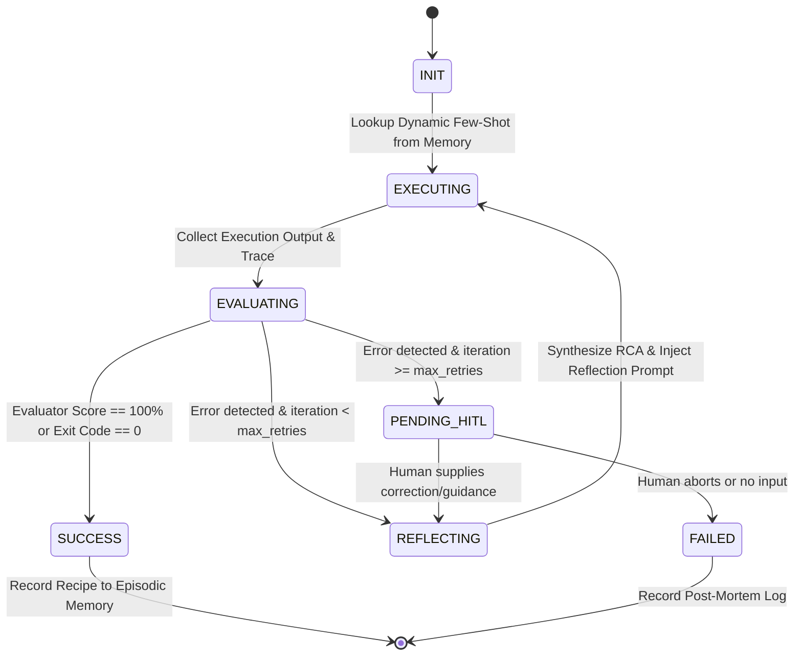

# Technical Specification: adaptive-self-healing-agent

- **Version:** 1.0.0
- **Status:** Approved
- **Target Skill Directory:** `/mnt/second_drive/SKILL/adaptive-self-healing-agent`

---

## 1. Overview & Objectives

The `adaptive-self-healing-agent` skill establishes an adaptive execution framework based on Reflexion, Corrective RAG (CRAG), and Memory-Augmented Feedback. It enables an agent to run an execution loop, evaluate its own results using deterministic checks or critic evaluation, perform root-cause analysis (RCA) upon failure, and self-correct across iterations (max 3–5). Upon successful recovery, it persists the failure-fix pair into Episodic Memory as a reusable dynamic few-shot recipe.

---

## 2. State Machine & Graph Specification

### 2.1 State Schema (`ReflexionState`)
```json
{
  "session_id": "string (UUID)",
  "task_goal": "string",
  "iteration": 0,
  "max_retries": 3,
  "status": "INIT | EXECUTING | EVALUATING | REFLECTING | PENDING_HITL | SUCCESS | FAILED",
  "active_prompt": "string",
  "few_shot_examples": [],
  "trace": [
    {
      "iteration": 0,
      "thought": "string",
      "action": "string",
      "output": "string",
      "exit_code": 0
    }
  ],
  "last_error": {
    "error_type": "SYNTAX | RUNTIME | ASSERTION | TIMEOUT | HALLUCINATION",
    "raw_message": "string",
    "failed_target": "string"
  },
  "rca_diagnosis": "string",
  "hitl_feedback": null,
  "persisted_recipe": null
}
```

### 2.2 Transition Matrix



---

## 3. Core Submodules

### 3.1 Trace Collector & Root Cause Analysis (RCA)
- Collects stdout/stderr, tool calls, and LLM thinking logs.
- Evaluates against:
  1. **Deterministic Gates:** Linters (`flake8`, `mypy`, `eslint`), unit tests (`pytest`), exit codes (`$? == 0`).
  2. **Critic Gates:** `agent-system critic` for compliance score, structural integrity, and prompt constraints.
- Categorizes errors into:
  - `SYNTAX_ERROR`: Code fails parsing/compilation.
  - `MISSING_DEPENDENCY`: Module/package not imported or installed.
  - `ASSERTION_FAILED`: Output doesn't match expected invariant.
  - `CONTEXT_OVERFLOW`: Exceeds budget (>3072 bytes).
  - `ENVIRONMENT_FLAKE`: Transient socket, port conflict, or timeout.

### 3.2 Reflection & Self-Correction Engine
- Injects a structured Reflection Payload on iteration `i + 1`:
  ```text
  [GOAL]: <Original User Objective>
  [FAILED ATTEMPT]: <Previous output snippet>
  [ERROR TRACE]: <Traceback or evaluator defect list>
  [RCA DIAGNOSIS]: <Root cause explanation>
  [DIRECTIVE]: Focus strictly on resolving the RCA diagnosis. Avoid repeating the same pattern.
  ```

### 3.3 Human-in-the-Loop (HITL) Checkpointer
- If retries exceed threshold (default 3), the agent suspends execution and enters `PENDING_HITL`.
- The user can supply a 1-line guidance directive, which is prepended to the working memory state to restart the loop with reset counters.

### 3.4 Episodic Memory & Dynamic Few-Shot Pipeline
- When a state transitions to `SUCCESS` after $\ge 1$ retry:
  - Generates a concise key: `RECIPE_<TASK_DOMAIN>_<ERROR_TYPE>`.
  - Saves via CLI: `agent-system memory recipe-record --key "<KEY>" --recipe "<COMPACT_SOLUTION>"`.
- At `INIT` of any future run:
  - Runs: `agent-system memory search --query "<GOAL_KEYWORDS>" --top-k 2`.
  - Injects matching previous successes into the prompt as Few-Shot demonstrations.

---

## 4. File Structure & Delivery Plan

```
/mnt/second_drive/SKILL/adaptive-self-healing-agent/
├── SKILL.md                          # Main entry point (Strictly < 3072 bytes)
├── references/
│   ├── graph-architecture.md         # Full State graph spec & DAG invariants
│   ├── rca-critic-matrix.md          # RCA classification heuristics & prompts
│   ├── memory-fewshot-injection.md   # Integration with agent-system memory
│   └── hitl-checkpointer.md          # Human-in-the-loop rerun & checkpoint protocols
└── scripts/
    └── reflexion_runner.py           # Production Python CLI state machine runner
```

---

## 5. Acceptance & Verification Gates

1. **Context Budget:** `SKILL.md` must be strictly under 3072 bytes (<3KB).
2. **Critic Audit:** `agent-system critic` must score 100/100 on `SKILL.md` and `reflexion_runner.py`.
3. **End-to-End Simulation:** `reflexion_runner.py` must run a simulated multi-step self-correction task (failing run 1, reflecting run 2, succeeding run 3, recording recipe to memory).
4. **Episodic Memory Registration:** Confirm recipe exists via `agent-system memory recipe-get`.
