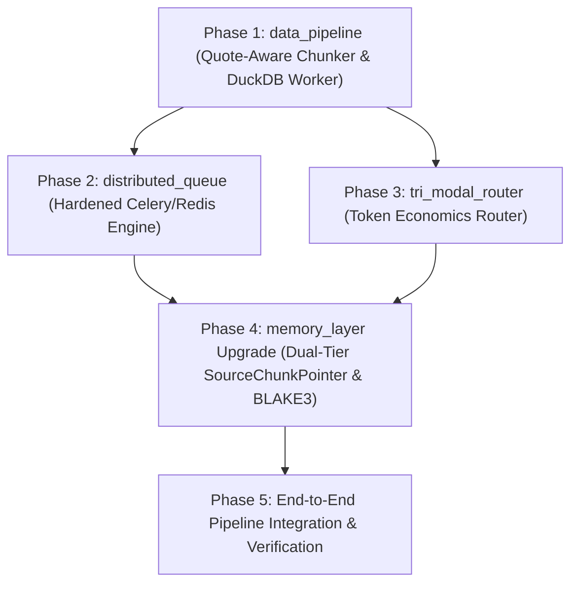

# Implementation Plan: Production-Grade Big Data & Heavy-Compute Agent Architecture

**Status:** IN PROGRESS  
**Execution Lead:** Lead Architect (Main Session)  
**Worker Allocation:** `flash` (Code Generation), `flash_lite` (Verification & Test Runs)

---

## 1. Phased Milestones & DAG

---

## 2. Detailed Task Breakdown

### Phase 1: `data_pipeline` Core Engine
* [ ] **Task 1.1**: Create `data_pipeline/__init__.py` and `data_pipeline/chunker.py`:
  - Implement `QuoteAwareChunker`: 2-pass deterministic byte-offset chunker respecting RFC 4180 multiline quotes.
* [ ] **Task 1.2**: Create `data_pipeline/worker.py`:
  - Implement `DuckDBWorker`: In-process analytical worker with `PRAGMA max_memory='2GB'`, NVMe disk spill, and Arrow zero-copy export.
* [ ] **Task 1.3**: Unit test suite `data_pipeline/tests/test_chunker_and_worker.py`:
  - Test case: Multiline CSV quotes split fracture resistance.
  - Test case: Bounded memory and disk spilling on heavy aggregation.

### Phase 2: `distributed_queue` Protocol
* [ ] **Task 2.1**: Create `distributed_queue/__init__.py` and `distributed_queue/celery_config.py`:
  - Enforce `task_acks_late=True`, `task_reject_on_worker_lost=True`, `visibility_timeout=86400`, `worker_prefetch_multiplier=1`.
* [ ] **Task 2.2**: Implement `distributed_queue/task_dispatcher.py`:
  - Dispatcher supporting Celery + fallback to bounded concurrent worker pool for local test isolation.
* [ ] **Task 2.3**: Unit test suite `distributed_queue/tests/test_queue_resilience.py`.

### Phase 3: `tri_modal_router` Token Economics
* [ ] **Task 3.1**: Create `tri_modal_router/__init__.py` and `tri_modal_router/router.py`:
  - Implement `route_task(task_payload)` evaluating:
    - Tier 0: Pure Code (DuckDB/Polars) -> 0 tokens.
    - Tier 1: Real-time Worker Pool (`flash_lite`/`flash`) -> 1-5s.
    - Tier 2: Asynchronous Batch API -> 50% discount, separate quota.
* [ ] **Task 3.2**: Unit test suite `tri_modal_router/tests/test_router.py`.

### Phase 4: `memory_layer` Upgrade (Dual-Tier `SourceChunkPointer`)
* [ ] **Task 4.1**: Upgrade `memory_layer/agent_hooks.py`:
  - Add `SourceChunkPointer` metadata support (`storage_uri`, `file_path`, `chunk_id`, `line_range`, `git_commit_sha`).
* [ ] **Task 4.2**: Upgrade `memory_layer/api.py`:
  - BLAKE3 idempotent UID generator for content-addressable deduplication.
* [ ] **Task 4.3**: Verify existing 12 tests in `memory_layer/tests` continue to pass 100%.

### Phase 5: End-to-End Map-Reduce Verification
* [ ] **Task 5.1**: Build `scripts/run_big_data_pipeline_demo.py`:
  - Generate a 10,000-row dataset with multiline customer reviews.
  - Split with `QuoteAwareChunker`.
  - Execute Map phase across parallel `DuckDBWorker` instances.
  - Reduce and aggregate with pure Python/DuckDB.
  - Feed aggregate insights into `memory_layer.post_task_hook` with `SourceChunkPointer`.
* [ ] **Task 5.2**: Dispatch `flash_lite` subagent to execute full test suite across all modules.
