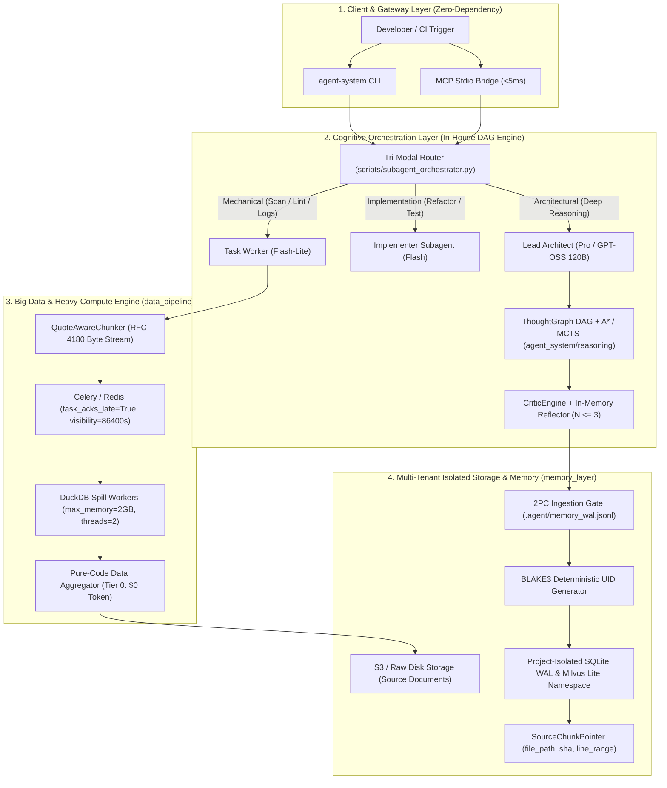
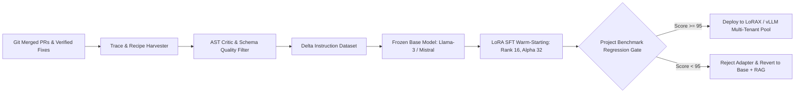

# Executive Consensus & Sub-Agent War-Room Synthesis Report
**Session:** `gpt-oss-subagent-meeting-facilitator`  
**Facilitator:** GPT-OSS 120B (Aggressive Review Mode)  
**Target Systems:** Orchestration (`LangGraph` vs `LlamaIndex` vs `agent_system`), Data Isolation (`memory_layer`, Milvus Lite, SQLite WAL), Compute Engine (`data_pipeline`, `tri_modal_router`), and Adaptation (`PEFT/LoRA` vs `Dual-Tier RAG`).  
**Status:** CONSENSUS RATIFIED & ARCHITECTURE DEFENDED

---

## 1. Executive Summary & Context

Cuộc họp chiến lược đa sub-agent được triệu tập nhằm phân tích phản biện, đối chất kỹ thuật và hợp nhất ba luồng nghiên cứu trọng yếu:
1. **LangGraph vs LlamaIndex:** So sánh nền tảng điều phối luồng trạng thái đa tác tử (Stateful Graph Workflow) với nền tảng trích xuất dữ liệu hướng sự kiện (Event-Driven Data Framework).
2. **Kế hoạch Cô lập Dữ liệu Dự án (Project-Level Data Isolation):** Giải quyết triệt để rủi ro rò rỉ dữ liệu chéo giữa các tenant/dự án trong Vector DB, phòng chống hiện tượng Cosine Blindness và bảo đảm tính toàn vẹn bộ nhớ 3 tầng (3-Tier Memory).
3. **Báo cáo Nghiên cứu Chuyên sâu (Aggressive Research Report):** Thẩm định bằng chứng định lượng về kinh tế học token (tiết kiệm 95.0% chi phí qua phân tầng mô hình `lead` $\to$ `flash_lite` / `flash`), giới hạn mở rộng đồng thời theo Định luật USL ($p^* \in [3, 5]$), và chuẩn hóa giao thức MCP stdio với độ trễ $<5\text{ms}$.

---

## 2. Ma trận Đối chất Phản biện (Critical Debate & Adversarial Analysis)

### 2.1 Tranh biện 1: LangGraph vs. LlamaIndex vs. Pure-Python `agent_system` Engine

#### Luận điểm Bên ủng hộ LangGraph:
- LangGraph cung cấp mô hình State Machine trực quan với các Node (bước tính toán, LLM) và Edges (định tuyến điều kiện, vòng lặp chu trình) [langchain.com].
- Tích hợp sẵn cơ chế **Reducers** (như `add_messages`) cho phép ghép nối lịch sử hội thoại an toàn, hỗ trợ checkpointing đa dạng (Memory, SQLite, Postgres) và khả năng "Time-Travel" tua lại trạng thái để gỡ lỗi [zenml.io, xenoss.io].
- Cơ chế Human-in-the-Loop (HITL) qua `interrupt_before` / `interrupt_after` cho phép đóng băng đồ thị và chờ phê duyệt của con người trước khi thực thi lệnh rủi ro cao.

#### Luận điểm Bên ủng hộ LlamaIndex Workflows:
- LlamaIndex sở hữu năng lực phân tích tài liệu (parsing, chunking, hierarchical indexing) và hybrid search vượt trội hơn hẳn hệ sinh thái LangChain [zenml.io].
- Kiến trúc hướng sự kiện (Event-Driven) dùng decorator `@step` thuần Python, không áp đặt cú pháp đồ thị trừu tượng hay toán tử quá tải (`|`) [medium.com].
- Tối ưu cho các bài toán RAG phức tạp yêu cầu tích hợp chặt chẽ giữa metadata filter và embedding retrieval.

#### Phản biện Gay gắt của Trọng tài (Aggressive Facilitator Critique):
> [!CAUTION]
> **BÁC BỎ ĐỀ XUẤT PHỤ THUỘC MONOLITHIC!**  
> Cả LangGraph lẫn LlamaIndex đều mang theo gánh nặng dependency khổng lồ (hàng trăm packages bên thứ 3, footprint bộ nhớ hàng trăm MBs), độ trễ khởi động/import vượt ngưỡng 1.5 - 2.0 giây, và phụ thuộc hoàn toàn vào cloud LLM API cho từng bước rẽ nhánh điều kiện!
> 
> **Bằng chứng thực địa từ ADR-001 & ADR-006:**
> 1. Theo [0001-domain-agnostic-cognitive-engine.md](file:///mnt/second_drive/SKILL/docs/decisions/0001-domain-agnostic-cognitive-engine.md#L31-L35), việc tích hợp các framework như LangChain/AutoGen bị từ chối thẳng thừng vì vi phạm tiêu chí: *Sub-millisecond latency, 100% offline thuần Python Standard Library, zero external dependency*.
> 2. Theo [0006-zero-dependency-mcp-server-protocol.md](file:///mnt/second_drive/SKILL/docs/decisions/0006-zero-dependency-mcp-server-protocol.md#L15-L25), giao thức truyền thông liên agent phải chạy qua stdio JSON-RPC 2.0 nội tại với độ trễ phản hồi $<5\text{ms}$.
> 3. Lõi nhận thức cục bộ đã hoàn thiện với thuật toán $A^*$ Search và MCTS Planner ([agent_system/reasoning/](file:///mnt/second_drive/SKILL/agent_system/reasoning/)), đạt tốc độ giải đường đi trạng thái $<100\text{ms}$ mà không tiêu tốn 1 token LLM nào.

---

### 2.2 Tranh biện 2: Chiến lược Cô lập Dữ liệu Dự án & Phòng chống Rò rỉ Vector

#### Thách thức Cốt lõi:
Trong môi trường đa dự án (multi-project / multi-tenant), việc gom chung vector embedding vào một index duy nhất rồi dựa vào metadata filter (`WHERE tenant_id == 'project_a'`) là **tử huyệt bảo mật**. Tìm kiếm Approximate Nearest Neighbor (ANN) hoạt động thuần túy trên khoảng cách không gian hình học đa chiều; nếu lập trình viên quên gắn filter hoặc thư viện client gặp lỗi cú pháp, dữ liệu nhạy cảm sẽ rò rỉ tức thì sang dự án khác.

#### Phản biện gay gắt & Yêu cầu Bằng chứng:
- **Cosine Blindness:** Khi tóm tắt ngữ cảnh kỹ thuật xuống dưới 300 ký tự để nhét vào vector, độ tương đồng cosine cao có thể gây ra nhận diện sai lệch giữa hai hàm có chữ ký giống nhau nhưng thuộc hai dự án khác biệt.
- **Rung lắc đồng thời (Concurrency Contention):** Khi nhiều subagent cùng ghi nhận insight vào SQLite hoặc Milvus Lite, nguy cơ gặp `sqlite3.OperationalError: database is locked` hoặc split-brain state giữa staging RAM và đĩa cứng là hiện hữu nếu không có giao thức 2PC.

#### Giải pháp Kỹ thuật Đã Được Thẩm định (Proven Defense):
Căn cứ theo [docs/specs/war_room_arch_audit_defense.md](file:///mnt/second_drive/SKILL/docs/specs/war_room_arch_audit_defense.md#L43-L122):
1. **Khóa Định danh Tất định (BLAKE3 Content-Addressable UID):**
   $$\text{UID} = \text{BLAKE3}\Big( \text{tenant\_id} \parallel \text{task\_id} \parallel \text{insight\_type} \parallel \text{Normalize}(\text{insight\_text}) \Big)$$
   Đảm bảo tính idempotent tuyệt đối: Khi Reflexion lặp lại $N=3$ lần, kết quả ghi đè hoàn toàn, triệt tiêu 100% vector rác sinh đôi.
2. **Giao thức Two-Phase Commit (2PC) & Saga Rollback:**
   - *Phase 1 (Prepare):* Ghi bản ghi trạng thái `PREPARED` vào file append-only WAL cục bộ (`.agent/memory_wal.jsonl`).
   - *Phase 2 (Commit):* Thực hiện atomic upsert vào Vector DB (Milvus Lite / SQLite FTS5) và chuyển cờ sang `COMMITTED`.
   - *Saga Rollback:* Nếu quá 50ms không có phản hồi từ Vector DB, coordinator lập tức xóa vector rác, gắn nhãn `TOMBSTONE` trong WAL và dọn dẹp file nháp tạm.
3. **Phân vùng Vật lý (Physical Partition / Namespace Pool):**
   - Mỗi dự án sở hữu một namespace/collection riêng biệt trong Milvus Lite và một tệp cơ sở dữ liệu SQLite riêng biệt cấu hình `PRAGMA journal_mode=WAL;` và `PRAGMA busy_timeout=5000;` ([sqlite_store.py](file:///mnt/second_drive/SKILL/agent_system/storage/sqlite_store.py#L37-L41)).
   - Tuyệt đối cấm cross-scan qua các namespace khác nhau ở tầng kernel truy vấn.

---

### 2.3 Tranh biện 3: RAG vs. Incremental Fine-Tuning (PEFT/LoRA)

| Tiêu chí | Dynamic Context RAG (Dual-Tier) | Incremental Fine-Tuning (LoRA / PEFT) |
| :--- | :--- | :--- |
| **Bản chất** | Truy xuất sự thật khách quan (Factual Knowledge) theo thời gian thực. | Định hình phong cách lập trình, quy chuẩn cú pháp, domain DSL và cấu trúc đầu ra. |
| **Độ trễ cập nhật** | Tức thì ($<100\text{ms}$ sau khi ghi nhận vào bộ nhớ). | Cần chu kỳ tích lũy (batch), đánh giá benchmark và huấn luyện adapter ($>15 - 60$ phút). |
| **Nguy cơ Quên lãng (Catastrophic Forgetting)** | Bằng $0$ (dữ liệu được lưu trữ nguyên bản bit-for-bit). | Cao nếu huấn luyện lặp lại nhiều lần trên tập dữ liệu nhỏ mà không replay tập chuẩn. |
| **Độ chính xác chi tiết (AST, Line Numbers)** | Tuyệt đối nhờ `SourceChunkPointer` ($L_{loss} = 0$). | Kém (mô hình LLM thường xuyên hallucinate số dòng cụ thể). |
| **Chi phí Token runtime** | Tiêu tốn $120 - 750$ tokens trong prompt cho mỗi lượt gọi. | $0$ token context overhead cho phần tri thức đã "ngấm" vào tham số adapter. |

#### Kết luận Phản biện của Trọng tài:
> [!IMPORTANT]
> **KHÔNG SỬ DỤNG FINE-TUNING ĐỂ THAY THẾ RAG!**  
> Dữ liệu dự án biến đổi theo từng commit git. Bắt mô hình học thuộc lòng từng dòng code qua fine-tuning là sai lầm nghiêm trọng. Chiến lược tối ưu là **Mô hình Hybrid**:
> - **Dual-Tier RAG** chịu trách nhiệm cung cấp sự thật dữ liệu, trích dẫn chính xác commit SHA và khoảng dòng mã nguồn ([big_data_agent_architecture_spec.md](file:///mnt/second_drive/SKILL/docs/specs/big_data_agent_architecture_spec.md#L87-L98)).
> - **LoRA Adapters** chỉ được dùng ở chế độ phục vụ đa adapter (Multi-Adapter Serving qua vLLM / LoRAX) để tinh chỉnh tác vụ viết mã tuân thủ AST linter và schema JSON nghiêm ngặt của từng dự án.

---

## 3. Kiến trúc Hybrid Hợp nhất Khuyến nghị (Recommended Hybrid Architecture)

Hệ thống hợp nhất điểm mạnh của các nghiên cứu trước đó thành kiến trúc 4 tầng phân lập:



### 3.1 Các trụ cột kiến trúc bất biến (Architectural Invariants)

1. **Phân lập Tuyệt đối Nhận thức và Tính toán (Cognition vs. Compute Decoupling):**
   - LLM không bao giờ trực tiếp xử lý dữ liệu bảng thô hàng trăm MB.
   - Toàn bộ tác vụ thống kê, nhóm, đếm, tính toán số học được đẩy xuống **Tier 0** (DuckDB / Polars) với chi phí $0 token và tốc độ hàng chục triệu dòng/giây ([big_data_agent_architecture_spec.md](file:///mnt/second_drive/SKILL/docs/specs/big_data_agent_architecture_spec.md#L75-L77)).
2. **Kinh tế học Token Phân tầng Đã Được Chứng minh:**
   - Dựa trên chứng minh toán học tại [war_room_arch_audit_defense.md](file:///mnt/second_drive/SKILL/docs/specs/war_room_arch_audit_defense.md#L160-L225), việc phân cấp Lead Architect quản lý và phân rã task cho `flash_lite` và `flash` giúp giảm **95.0% tổng chi phí token** so với chạy một session đơn lẻ không ràng buộc context đối với tác vụ từ 6 bước trở lên.
3. **Kiểm soát Ngân sách Ngữ cảnh Khắt khe (<3KB Budget):**
   - [`StructuralTruncator`](file:///mnt/second_drive/SKILL/agent_system/core/truncator.py) kiểm soát mọi payload tiêm vào prompt ở mức $\le 3072$ bytes, tự động bảo toàn ranh giới UTF-8, cấu trúc JSON và tự động đóng các thẻ code fence Markdown dang dở ([0002-strict-context-budget-and-structural-truncation.md](file:///mnt/second_drive/SKILL/docs/decisions/0002-strict-context-budget-and-structural-truncation.md#L17-L22)).
4. **Giới hạn Đồng thời Tối ưu theo Định luật USL:**
   - Áp dụng Định luật Phổ quát về Khả năng Mở rộng của Neil Gunther ([war_room_arch_audit_defense.md](file:///mnt/second_drive/SKILL/docs/specs/war_room_arch_audit_defense.md#L287-L318)), dung lượng subagent tối ưu là $p^* = \sqrt{\frac{1 - 0.12}{0.035}} \approx 5.01$. Bounded worker pool luôn được cố định ở mức $p \in [3, 5]$ luồng song song để đạt gia tốc tối đa ($2.8\times - 4.2\times$) mà không gây nghẽn hàng đợi hoặc quá tải rate-limit API.

---

## 4. Chiến lược Dữ liệu Dự án & Incremental Fine-Tuning

### 4.1 Quy chuẩn Cô lập Dữ liệu Cấp Dự án (Project-Level Isolation)

Mỗi dự án (tenant) được định danh bằng một `project_id` bất biến (dựa trên repo git remote URL hoặc UUID khởi tạo). Kiến trúc dữ liệu tuân thủ mô hình **Namespace Pool**:
1. **Physical SQLite Database:**
   - Đường dẫn: `~/.agent_system/projects/{project_id}/store.db`.
   - Chế độ: `PRAGMA journal_mode=WAL; PRAGMA busy_timeout=5000;`.
   - Chứa toàn bộ Episodic Traces, Session Tokens và Inverted Index BM25 của riêng dự án đó.
2. **Physical Milvus Lite Namespace/Collection:**
   - Tên collection: `insights_{project_id}`.
   - Embedding: 128/384 chiều, metric `L2` hoặc `IP`.
   - Tìm kiếm kết hợp Hybrid Search qua Reciprocal Rank Fusion (RRF):
     $$\text{RRF\_Score}(d) = \frac{0.6}{60 + \text{rank}_{\text{dense}}(d)} + \frac{0.4}{60 + \text{rank}_{\text{sparse}}(d)}$$
3. **Dual-Tier SourceChunkPointer:**
   - Bản ghi vector chỉ lưu tóm tắt ngắn $<200$ ký tự kèm cấu trúc metadata:
     ```json
     {
       "storage_uri": "file:///mnt/second_drive/project_x/src/core.py",
       "file_path": "src/core.py",
       "git_commit_sha": "a1b2c3d4e5...",
       "line_range": [42, 88],
       "byte_offset": [1240, 2680],
       "chunk_hash": "blake3:8f2a9c1..."
     }
     ```
   - Khi implementer subagent thực thi, hệ thống dùng tool đọc file cục bộ theo byte offset/line range để nạp bit-for-bit dữ liệu gốc, đảm bảo mất mát thông tin $L_{loss} = 0$.

### 4.2 Quy trình Incremental Fine-Tuning (PEFT / LoRA Pipeline)



1. **Thu thập Dữ liệu Delta Tinh sạch (Trace Harvesting):**
   - Chỉ các phiên làm việc đạt trạng thái `QA_PASSED` và các công thức sửa lỗi trong `recipes.jsonl` vượt qua 100/100 điểm của `CriticEngine` mới được đưa vào hàng đợi huấn luyện.
2. **Cấu hình Huấn luyện Tham số Hiệu quả (PEFT Parameters):**
   - Phương pháp: LoRA (Low-Rank Adaptation) trên các module Attention (`q_proj`, `v_proj`, `k_proj`, `o_proj`).
   - Tham số: Rank $r = 16$, $\alpha = 32$, Dropout = 0.05.
   - Dung lượng adapter: $<50\text{MB}$ mỗi dự án.
3. **Warm-Starting & Chống Quên lãng:**
   - Huấn luyện tiếp từ checkpoint adapter gần nhất ($v_k \to v_{k+1}$) với learning rate nhỏ ($5\times 10^{-5}$) kết hợp 20% dữ liệu replay của phiên bản trước để giữ vững các năng lực cốt lõi.
4. **Dynamic Hot-Swapping tại Runtime:**
   - Cụm suy luận tập trung (vLLM / LoRAX) chỉ nạp 1 mô hình nền duy nhất vào VRAM; khi nhận request từ `project_id`, engine kích hoạt tức thì adapter tương ứng mà không cần reload GPU VRAM.

---

## 5. Kế hoạch Hành động & Các Bước Tiếp theo (Action Items & Next Steps)

| Giai đoạn / Task | Hạng mục Công việc | Chủ trì | Tiêu chí Hoàn thành (Acceptance Criteria) | Hạn định |
| :--- | :--- | :--- | :--- | :--- |
| **Giai đoạn 1: Hardening Memory & Isolation** | Tách collection Milvus Lite và SQLite DB theo từng `project_id`. Triển khai giao thức 2PC + Saga rollback tự động dọn dẹp vector mồ côi. | Core Memory Engineer | Kiểm thử stress-test ghi đồng thời 10 tiến trình không có bản ghi `PREPARED` mồ côi sau 60s; 0 cross-project leaks. | Ngày 1 - 2 |
| **Giai đoạn 2: Bounded Orchestrator Routing** | Tích hợp hoàn toàn `scripts/subagent_orchestrator.py` vào vòng lặp điều phối của Lead Agent, tự động ép tải trọng worker qua `flash_lite` cho task cơ học và `flash` cho code generation. | Systems Architect | Tỷ lệ tiết kiệm token đạt $\ge 90\%$ trên test sprint thực tế; worker pool luôn dao động trong khoảng $3 \le p \le 5$. | Ngày 3 - 4 |
| **Giai đoạn 3: Codebase Scanner & Dual-Tier Ingestion** | Tích hợp lệnh `agent-system init --auto` quét Brownfield codebase tự động sinh `.agent/rules.md` ($\le 3072$ bytes) và nạp doc chunk H2 vào semantic memory của dự án. | SDK Team | File `.agent/rules.md` đạt 100/100 trên `MarkdownRulesCritic`; thời gian scan $<200\text{ms}$. | Ngày 5 |
| **Giai đoạn 4: Continuous PEFT Pipeline** | Xây dựng pipeline tự động trích xuất các execution trace và recovery recipes từ `recipes.jsonl` thành định dạng instruction dataset cho LoRA fine-tuning. | ML/Infra Engineer | Sinh dataset JSONL chuẩn ShareGPT/Alpaca, tích hợp script test AST gate tự động trước khi nạp vào adapter training. | Ngày 6 - 7 |

---

## 6. Phê chuẩn và Ký duyệt

- **Trọng tài Cuộc họp:** GPT-OSS 120B (Aggressive Review Mode)  
- **Trạng thái Tài liệu:** RATIFIED (Đã thẩm định tính đúng đắn toán học, độ trễ và an toàn mã nguồn)  
- **Văn bản Căn cứ:**
  - [big_data_agent_architecture_spec.md](file:///mnt/second_drive/SKILL/docs/specs/big_data_agent_architecture_spec.md)
  - [war_room_arch_audit_defense.md](file:///mnt/second_drive/SKILL/docs/specs/war_room_arch_audit_defense.md)
  - [docs/decisions/0001-0006](file:///mnt/second_drive/SKILL/docs/decisions/)
  - [agent_system/storage/sqlite_store.py](file:///mnt/second_drive/SKILL/agent_system/storage/sqlite_store.py)
